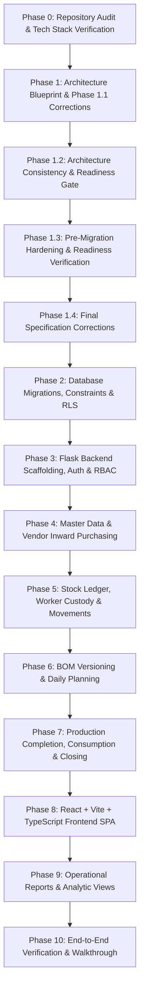

# Implementation Roadmap & Phase-by-Phase Execution Plan

**Project:** Packing Material Inventory & BOM Management System  
**Document Version:** 1.15.0  
**Status:** Phase 7 database/backend verified. Phase 8 application and frontend/MSW workflow CI verified (30 tests across 6 files, strict npm audit with zero vulnerabilities, TypeScript and production build); live JWT/RLS validation and public SPA/Flask deployment smoke test remain gated on environment provisioning.  
**Date:** 2026-10-20  

---

## 1. Execution Principles & Phase Governance

1. **Database Readiness Gate First:** All architectural specifications, 33 table schemas, hardened security definer functions, fail-closed profile column protection triggers, 5-variable quantity conservation invariants, single active BOM version partial indexes, two-tier idempotency scheme with ephemeral response caching, leaf-only location movement matrices, and complete RLS matrices must be verified and documented before creating or running SQL migration scripts.
2. **Database Invariants First:** No business logic or UI is built before database tables, check constraints, row-level locks, and RLS policies are fully applied and verified.
3. **Backend Stock Engine Before UI:** All stock movements, conversions, and transactions must be tested with automated `pytest` suites before building React components.
4. **No Mocks in Final Deliverable:** All features must execute against live PostgreSQL database instances.
5. **Zero Secrets in Git:** All secrets reside in `.env` files matching `.env.example`.
6. **Anti-Cascade Protection:** Historical production records, snapshots, and ledger movements must never be cascade-deleted (`ON DELETE RESTRICT`).

---

## 2. Phase-by-Phase Implementation Roadmap

---

### Phase 2: Supabase Schema Migrations, Invariant Constraints & Row Level Security (RLS)
- **Scope:**
  - Create version-controlled SQL migration scripts for all **33 relational tables** defined in `docs/SYSTEM_DESIGN.md` (including `material_categories`, atomic `material_location_balances`, Table 31 permanent `idempotency_keys`, Table 32 ephemeral `idempotency_responses`, and Table 33 `audit_logs`).
  - Implement restrictive foreign keys (`ON DELETE RESTRICT`) on all production history, snapshots, and transactions to prevent cascading data loss.
  - Implement strongly-typed stock movement references across all 9 movement types, eliminating polymorphic references and eliminating circular FK between `stock_adjustments` and `stock_transactions` (single-direction FK from `stock_transactions.stock_adjustment_id` to `stock_adjustments.id`).
  - Implement **Two-Tier Idempotency Architecture** resolving retention vs FK conflict:
    - Table 31 `idempotency_keys`: Permanent immutable request-identity header with client-supplied text token `idempotency_key` as primary key (no surrogate UUID row-ID column), JWT-derived `owner_id`, server-normalized `operation_scope`, canonical request hash, `status`, `resource_type` (10-value enum checked by `chk_idempotency_keys_resource_type` covering `'GOODS_RECEIPT'`, `'PRODUCTION_COMPLETION'`, `'STOCK_TRANSACTION'`, `'STOCK_ADJUSTMENT'`, `'PURCHASE_ORDER'`, `'DAILY_PLAN'`, `'PACKING_JOB'`, `'DAILY_CLOSING'`, `'BOM'`, `'PROFILE'`), `resource_id`, and timestamps. Retained permanently; never pruned.
    - Table 32 `idempotency_responses`: Ephemeral HTTP response cache (`idempotency_key` FK with `ON DELETE CASCADE`, `response_status_code`, `response_body`, `expires_at`). Pruned periodically by background worker without touching headers.
    - Historical stock movements reference `idempotency_keys(idempotency_key)` with `ON DELETE RESTRICT`, preserving ledger auditability and avoiding FK deletion errors (`SQLSTATE 23503`). Public API success responses (`StockMovementResponse`, `StockAdjustmentDetailResponse`) do not expose an invented surrogate `idempotencyKeyId`; entities are identified by their domain IDs.
    - Both `idempotency_keys` and `idempotency_responses` strictly deny all direct PostgREST access (`USING (false)` / default-deny); accessible solely through authorized transactional stored procedures.
    - Expired replays return safe **HTTP 410 `IDEMPOTENCY_RESPONSE_EXPIRED`** with camelCase `resourceReference` (`resourceType`, `resourceId`, `operationCompletedAt`), guaranteeing that expired operations are never re-executed.
  - Implement the rollback-removes-key strategy: header, domain changes, multi-row ledger/projection updates, and successful response cache share one transaction; failures leave no `FAILED` header or partial stock state.
  - Implement 5-variable quantity conservation check constraint on `packing_jobs`:
    `CHECK (current_revised_quantity = completed_quantity + pending_quantity + cancelled_quantity)`.
  - Implement check constraints (`quantity > 0`, non-negative server-calculated receipt quantities, `CHECK (on_hand_quantity >= 0)`). Unit normalization and accepted-quantity arithmetic occur in the trusted receipt procedure, not a mixed-unit row CHECK.
  - Replace mixed-unit receipt arithmetic with a trusted GRN posting procedure that derives accepted and canonical quantities from original entered/rejected measurements and persists frozen conversion provenance.
  - Add a material canonical-unit protection trigger: reject a canonical-unit change after any transaction, reservation, or released snapshot; use replacement variants for post-activity corrections.
  - Implement single active BOM version enforcement via partial unique index:
    `CREATE UNIQUE INDEX idx_boms_single_active_version ON boms (product_id, party_id, packing_variant_name) NULLS NOT DISTINCT WHERE (status = 'ACTIVE')`.
  - Implement source-optional packing jobs: nullable `packing_jobs.master_bom_id` and the strict custom/master snapshot discriminator. Release procedures must reject empty/incomplete custom snapshots before status transition or reservation creation.
  - Implement composite shift closing alignment constraint:
    `FOREIGN KEY (daily_plan_id, shift_code) REFERENCES daily_plans(id, shift_code)`.
  - Implement the exhaustive nine-row movement reference CHECK plus a posting trigger/procedure for cross-table active-leaf, type, direction, worker/job/completion, receipt, and adjustment validation. A CHECK must not look up `locations`.
  - Implement location topology triggers preventing postings to inactive/parent locations and unsafe deactivate, parent conversion, reclassification, or parentage changes after balances, reservations, assignments, or movement history.
  - Create hardened `SECURITY DEFINER` helper `public.get_current_user_role()` with `SET search_path = ''` and fully-qualified names.
  - Implement `BEFORE UPDATE` trigger `trg_protect_profile_role` on `public.profiles` with fail-closed condition:
    `IF public.get_current_user_role() IS DISTINCT FROM 'ADMIN' THEN RAISE EXCEPTION ...` to strictly forbid non-admin mutation of `role` and `is_active`.
  - Implement `admin_update_profile_access` as the only privileged access-change RPC. It must derive and authorize the active administrator from the actual JWT `auth.uid()`, accept no actor identifier, have narrow EXECUTE grants, audit each change, and not rely on a service-role identity.
  - Implement Row Level Security (RLS) on all 33 tables with default-deny policies per the complete RLS matrix.
  - Lock out direct client-side PostgREST writes to `stock_transactions`, `material_location_balances`, `stock_reservations`, `packing_job_bom_snapshots`, `daily_closings`, `idempotency_keys`, `idempotency_responses`, and `audit_logs`.
  - Create atomic PostgreSQL stored functions for inventory mutations (`fn_post_stock_transaction`, `fn_release_daily_plan`).
- **Files / Modules Expected to Change:**
  - `supabase/migrations/20261015000001_initial_schema.sql`
  - `supabase/migrations/20261015000002_rls_policies.sql`
  - `supabase/migrations/20261015000003_inventory_functions.sql`
  - `supabase/seed.sql` (Initial standard units, default categories, admin profile, test locations)
- **Dependencies:** Supabase CLI or direct PostgreSQL connection string.
- **Required Tests:**
  - Migration idempotency test (run up, down, up).
  - Check constraint violation tests (negative stock, negative quantities, 5-variable equation violation).
  - Profile self-escalation trigger test with fail-closed check (non-admin updating own `role` or `is_active` must be rejected with 42501).
  - RLS verification tests (assert anon/authenticated roles cannot insert into `stock_transactions`, `idempotency_keys`, `idempotency_responses`, or `audit_logs`).
  - Foreign key restrict test (verify deleting a plan with jobs fails with `ON DELETE RESTRICT`).
  - Stock movement reference integrity test across all 9 movement types.
  - Active leaf/type validation and prohibited location topology transition tests.
  - Administrator role-change RPC tests: valid admin, normal/missing/inactive caller, denied direct update, and deactivated-user self-reactivation denial.
  - Single active BOM index test (activating a 2nd BOM for identical product/party/variant is rejected).
  - Two-tier idempotency retention tests: pruning `idempotency_responses` leaves headers and stock references intact without FK violation; retrying expired key returns HTTP 410 without re-executing operation; cross-user/cross-endpoint replay returns generic 409 non-disclosure; concurrent duplicate requests serialize safely.
- **Acceptance Criteria:**
  - All 33 tables created cleanly without warnings.
  - RLS enabled on 100% of 33 tables.
  - Direct insert or select on `idempotency_keys` and `idempotency_responses` via PostgREST is rejected.
  - Direct insert to `stock_transactions` via PostgREST is rejected with 403 Forbidden.
  - Non-admin profile role update is rejected with SQL exception 42501.
- **Risks & Rollback:**
  - *Risk:* Flawed RLS policy locks out legitimate backend queries.
  - *Mitigation:* Use narrowly scoped procedures. Access changes carry the actual verified administrator JWT to the RPC; a service credential is never treated as the administrator.
  - *Rollback:* Down migration script drops created tables.

---

### Phase 3: Flask Backend Scaffolding, Auth & RBAC Foundation
- **Scope:**
  - Initialize Python virtual environment with `pip` / `uv`.
  - Scaffold Flask application factory (`backend/app/__init__.py`).
  - Configure environment variables via `pydantic-settings` / `python-dotenv`.
  - Implement Supabase Auth JWT verification decorator (`@require_auth`, `@require_role`). The Flask API defines 33 operations (20 POST commands, 13 GET queries). Exactly 32 operations are protected and require a valid Bearer token; `GET /api/v1/health` is explicitly unauthenticated.
  - Build centralized JSON error formatting with machine-readable error codes and request IDs (`UnauthorizedResponse`, `ForbiddenResponse`, `ConflictResponse`, `ErrorResponse`, `IdempotencyExpiredResponse`).
  - Implement request validation using Marshmallow or Pydantic.
  - Implement Two-Tier `Idempotency-Key` handling:
    - Validate bounded key format (16–128 ASCII chars `^[A-Za-z0-9_\-\.:]{16,128}$`).
    - Extract verified `owner_id` from JWT `auth.uid()` (never client-supplied).
    - Server-normalize `operation_scope` (`METHOD:/route/template`).
    - Calculate deterministic SHA-256 canonical request payload hash.
    - Transactional database lock: inspect existing key; if completed, check `idempotency_responses`. If present, return cached response; if expired/pruned, return HTTP 410 `IDEMPOTENCY_RESPONSE_EXPIRED` with camelCase `resourceReference` (`resourceType`, `resourceId`, `operationCompletedAt`). If key reused with different owner/scope/hash, return generic HTTP 409 `IDEMPOTENCY_KEY_REUSED` without disclosing cached payloads.
    - Rollback-removes-key on failure; successful transactions commit header, cache, and domain operations atomically.
  - Implement background retention pruning worker for expired response caches (`DELETE FROM idempotency_responses WHERE expires_at < NOW()`).
  - Set up `pytest` test suite with database fixtures.
- **Files / Modules Expected to Change:**
  - `backend/requirements.txt`
  - `backend/.env.example`
  - `backend/app/__init__.py`
  - `backend/app/config.py`
  - `backend/app/auth.py`
  - `backend/app/errors.py`
  - `backend/app/idempotency.py`
  - `backend/app/tasks/pruning.py`
  - `backend/tests/conftest.py`
  - `backend/tests/test_auth.py`
  - `backend/tests/test_health.py`
  - `backend/tests/test_idempotency.py`
- **Dependencies:** Phase 2 migrations applied.
- **Required Tests:**
  - `GET /api/v1/health` (unauthenticated probe) returns HTTP 200 and DB connected. All other 32 operations reject requests missing an `Authorization` header with 401.
  - JWT verification test with valid, expired, and tampered tokens.
  - Role-based authorization test (`OPERATOR` cannot access `/admin/*`).
  - Matching replay before expiry returns cached 2xx without duplicate movements.
  - Retrying expired key returns HTTP 410 `IDEMPOTENCY_RESPONSE_EXPIRED` without re-execution.
  - Cross-user and cross-endpoint replay attempts return generic HTTP 409 without leaking data.
  - Concurrent duplicate request serialization test.
  - Rollback-removes-key failure test.
- **Acceptance Criteria:**
  - Backend starts cleanly, connects to PostgreSQL, and validates tokens correctly.
  - Two-tier idempotency middleware correctly intercepts and manages mutating requests.
- **Risks & Rollback:**
  - *Risk:* JWT public key mismatch.
  - *Mitigation:* Support both Supabase shared secret and JWKS endpoint URL in configuration.
  - *Rollback:* Down migration script drops created tables.

---

### Phase 4: Master Data Catalogs & Vendor Inward Purchasing (PO & GRN)
- **Scope:**
  - Verify and test direct PostgREST master CRUD endpoints (`/rest/v1/material_categories`, `/parties`, `/products`, `/vendors`, `/units`, `/locations`, `/workers`, `/materials`, `/material_conversions`) under PostgreSQL RLS and triggers.
  - Implement Flask endpoints for Purchase Orders (`POST /api/v1/purchase-orders`, `GET /api/v1/purchase-orders/{id}`).
  - Implement Inward Goods Receipt (GRN) posting service (`POST /api/v1/goods-receipts/post`, `GET /api/v1/goods-receipts/{id}`):
    - Validates vendor, invoice date, received date, and receiving location.
    - Accepts only original entered/rejected quantities with explicit units and physical evidence; derives accepted/canonical quantities server-side.
    - Captures packaging units (`box_count`, `weight_kg`, `pcs_count`) and frozen conversion rule ID, factor, direction, and exact/estimated classification.
    - Atomically updates GRN status to `POSTED`.
    - Generates and appends `PURCHASE_RECEIPT` movements to `stock_transactions`.
- **Files / Modules Expected to Change:**
  - `backend/app/services/master_service.py`
  - `backend/app/services/purchasing_service.py`
  - `backend/app/routes/masters.py`
  - `backend/app/routes/purchasing.py`
  - `backend/tests/test_masters.py`
  - `backend/tests/test_purchasing.py`
- **Dependencies:** Phase 3 backend foundation.
- **Required Tests:**
  - Dynamic material category creation without code changes.
  - Post 25 KG poly bags inward receipt from original measurements only and verify the returned trusted calculation/provenance.
  - Reject a post-activity canonical-unit change and verify original balances/snapshots remain unchanged.
  - Verify posting GRN credits shelf balance exactly once and is protected by `ON DELETE RESTRICT`.
- **Acceptance Criteria:**
  - Inward goods receipts post atomically and stock balances reflect actual delivered quantities.

---

### Phase 5: Authoritative Stock Ledger, Worker Custody & Inventory Movements
- **Scope:**
  - Implement `GET /api/v1/stock/balances`, `GET /api/v1/stock/ledger`, `GET /api/v1/stock/worker-custody`, `GET /api/v1/stock/transactions/{id}`, and `GET /api/v1/stock/adjustments/{id}` with bounded filters and pagination.
  - Implement core stock query engine: balances across all **6 Facility Node Types** (`STORE_SHELF`, `RECEIVING_BAY`, `SHOP_FLOOR_BUFFER`, `WORKER_CUSTODY`, `DAMAGE_QUARANTINE`, `DISPATCH`), transaction ledger, worker custody summary.
  - Implement signed aggregation equation and synchronize `material_location_balances` on leaf nodes.
  - Implement atomic movement services with row-level locks:
    - `POST /api/v1/stock/issue-to-worker`: Transfers stock to worker custody location.
    - `POST /api/v1/stock/return-from-worker`: Transfers stock from worker custody back to warehouse shelf or buffer.
    - `POST /api/v1/stock/transfer`: Transfers stock between store shelves, buffers, and dispatch staging.
    - `POST /api/v1/stock/damage-quarantine`: Segregates damaged stock to quarantine bay without reducing physical stock.
    - `POST /api/v1/stock/scrap-disposal`: Permanently writes off condemned quarantined scrap.
    - `POST /api/v1/stock/adjustments`: Posts cycle count adjustments with supervisor attribution.
- **Files / Modules Expected to Change:**
  - `backend/app/services/stock_service.py`
  - `backend/app/routes/stock.py`
  - `backend/tests/test_stock_ledger.py`
  - `backend/tests/test_worker_custody.py`
  - `backend/tests/test_concurrency.py`
  - `backend/tests/test_quarantine_disposal.py`
- **Dependencies:** Phase 4 master data.
- **Required Tests:**
  - Signed aggregation equation test ($\sum \text{dest} - \sum \text{src}$).
  - Multi-location rollup test ensuring no double counting of parent locations.
  - Damage quarantine vs scrap disposal physical stock preservation test.
  - Concurrency race condition test (simultaneous issues cannot overspend stock).
- **Acceptance Criteria:**
  - Zero negative stock occurrences; worker custody reflects exact shop-floor items.

---

### Phase 6: Bill of Materials (BOM) Versioning & Daily Planning Scheduler
**Implementation status (2026-10-20):** Merged to `main` and applied to the linked Supabase project. Backend validation: 78 pytest tests plus Ruff; database validation: 260 pgTAP assertions across 11 suites. Post-migration verification confirmed all 33 core tables retain RLS, direct writes to BOM/planning/job tables are disabled, and the single-active-BOM index remains present. The Flask server has not been deployed. See [Phase 6 implementation report](PHASE_6_BOM_PLANNING_IMPLEMENTATION_REPORT.md).

- **Scope:**
  - Implement Master BOM creation with `NULLS NOT DISTINCT` uniqueness and single active version enforcement via partial unique index `idx_boms_single_active_version`.
  - Implement atomic BOM activation procedure: within a single transaction, the existing active BOM is superseded and the new version is activated.
  - Implement party-specific BOM overrides.
  - Implement Daily Packing Plan creation with multi-job scheduler, `shift_code`, and support for standard or completely customized packing recipes.
  - Support repeated party and product combinations with distinct BOMs/specs.
  - Implement Plan Release service:
    - Atomically freezes immutable BOM snapshots and conversion factors into `packing_job_bom_snapshots` and `snapshot_lines`.
    - For customized jobs without a master BOM (`is_customized = true`), allows nullable `source_bom_id` while strictly enforcing a complete, non-empty set of frozen snapshot lines before job release.
    - Creates material reservations in `stock_reservations`.
  - Implement 5-variable Job Quantity Revision and Cancellation service enforcing:
    $\text{current\_revised\_quantity} = \text{completed\_quantity} + \text{pending\_quantity} + \text{cancelled\_quantity}$.
  - Reject any revision below `completed_quantity` with HTTP 422 and preserve all completion history; route any overproduction case through a separately approved exception workflow.
- **Files / Modules Expected to Change:**
  - `backend/app/services/bom_service.py`
  - `backend/app/services/planning_service.py`
  - `backend/app/routes/boms.py`
  - `backend/app/routes/planning.py`
  - `backend/tests/test_boms.py`
  - `backend/tests/test_planning.py`
  - `backend/tests/test_revisions.py`
- **Dependencies:** Phase 5 stock engine.
- **Required Tests:**
  - Single active BOM index test (activating duplicate active BOM for identical recipe key is rejected).
  - Atomic release procedure test (prior active BOM superseded, new active BOM activated in single transaction).
  - Customized source-less BOM snapshot release test (assert valid frozen lines, nullable source BOM).
  - Multi-job scheduling with repeated products and distinct BOMs.
  - 5-variable quantity revision 520 $\to$ 450 with 100 packed and 350 cancelled remainder.
  - Job cancellation reconciling custody and output with `ON DELETE RESTRICT`.
  - Master BOM version bump does not alter historical job snapshots.
- **Acceptance Criteria:**
  - Frozen snapshots remain completely immutable; reservations accurately reflect active plan requirements; at most one active BOM per recipe key.

---

### Phase 7: Production Completion, Consumption, Variance Engine & Daily Closing

**Status:** Implemented and verified. Backend CI: 90 tests passed and Ruff passed; database CI completed successfully; hosted Supabase migration applied and schema/RPC privileges verified. See `docs/PHASE_7_PRODUCTION_CLOSING_IMPLEMENTATION_REPORT.md`. The Flask runtime has not yet been deployed.
- **Scope:**
  - Implement Production Output recording service (`POST /api/v1/production/completions`):
    - Records partial or full batch completions (e.g., 530 units packed of 1,000 planned).
    - Automatically calculates theoretical BOM material requirements.
    - Accurately tracks three-tier consumption: theoretical BOM requirement, auto-BOM backflush deduction (`posted_ledger_quantity = theoretical_quantity`, `is_estimated = true`), and nullable physically confirmed actual consumption (`physically_confirmed_quantity`).
    - Explicitly records `variance_status` enum (`UNVERIFIED`, `VERIFIED_ZERO`, `VARIANCE_RECORDED`). During automatic backflush without physical counts, `physically_confirmed_quantity = NULL`, `variance_quantity = NULL`, and `variance_status = 'UNVERIFIED'` (never falsely claiming variance zero).
    - Logs detailed consumption and variance status in `material_consumption_records`.
    - Updates job pending units and status (`PARTIALLY_COMPLETED` / `COMPLETED`).
  - Implement Shift-Aware Daily Closing service (`POST /api/v1/closings`):
    - Enforces composite shift alignment constraint `FOREIGN KEY (daily_plan_id, shift_code) REFERENCES daily_plans(id, shift_code)` and `UNIQUE(daily_plan_id)`.
    - Summarizes planned, completed, pending, and cancelled units.
    - Reconciles expected usage against recorded returns and worker custody; checks quarantine stock.
    - Handles pending unit disposition (carry forward, reschedule, cancel).
    - Locks daily plan status to `CLOSED`.
- **Files / Modules Expected to Change:**
  - `backend/app/services/production_service.py`
  - `backend/app/services/closing_service.py`
  - `backend/app/routes/production.py`
  - `backend/app/routes/closing.py`
  - `backend/tests/test_production.py`
  - `backend/tests/test_closing.py`
- **Dependencies:** Phase 6 planning & snapshots.
- **Required Tests:**
  - 530 units packed theoretical BOM scaling, backflush labeling, and unverified variance status verification.
  - Physical count verification updating `variance_status` from `UNVERIFIED` to `VARIANCE_RECORDED`.
  - Shift closing checklist, unreturned custody detection, composite shift FK integrity, and authorized override.
- **Acceptance Criteria:**
  - End-of-shift operational cycle closes cleanly with zero untracked material discrepancies; theoretical backflush never misrepresents variance as confirmed zero.

---

### Phase 8: React + Vite + TypeScript Frontend Application & Workflows

**Status:** Frontend CI passes on commit 26a1f479: 30 tests across 6 files, zero npm audit vulnerabilities, TypeScript and production build passed. Automated UI/API-contract workflows now cover purchasing/GRN, dual-unit preview, custom and versioned BOM planning, quantity conservation, production verification, custody, quarantine/scrap, closing, dynamic catalogs and fail-closed role entry. Phase 8 production release remains gated by live JWT/RLS tests and a deployed SPA-to-Flask smoke test. The linked Supabase project has 33/33 tables with RLS + FORCE RLS and 61 policies, but currently has zero Auth users and zero application profiles; no public SPA/API deployment target is configured. See docs/PHASE_8_FRONTEND_IMPLEMENTATION_REPORT.md and docs/PHASE_8_SCENARIO_MATRIX.md.
- **Scope:**
  - Scaffold React 19 + Vite + TypeScript application in `frontend/`.
  - Establish Vanilla CSS design system with responsive tokens.
  - Build core application layout: Header with Shift Selector, Collapsible Sidebar, Notification Tray.
  - Implement all 13 operational screens documented in `docs/UI_UX_WALKTHROUGH.md`:
    - Dashboard with KPI cards and active jobs grid.
    - Master categories and materials catalog (with category picker and dynamic JSON specs).
    - Purchasing & Inward GRN posting screen with dual-unit preview.
    - Current stock balances and searchable transaction ledger (partitioning usable, custody, quarantine).
    - Damage quarantine and scrap disposal modals.
    - Worker custody issuance and return modals.
    - BOM studio with version diff viewer.
    - Daily planning scheduler with multi-job repeated product and shift support.
    - Packing job detail with revision (520 $\to$ 450) and cancellation wizards.
    - Production completion entry with theoretical vs actual consumption toggle.
    - Daily closing console with shift-level discrepancy checklist.
- **Files / Modules Expected to Change:**
  - `frontend/package.json`
  - `frontend/vite.config.ts`
  - `frontend/src/index.css`
  - `frontend/src/main.tsx`
  - `frontend/src/App.tsx`
  - `frontend/src/lib/supabase.ts`
  - `frontend/src/lib/api.ts`
  - `frontend/src/lib/domain.ts`
  - `frontend/src/components/*`
  - `frontend/src/pages/*`
  - `frontend/src/lib/*.test.ts`
  - `frontend/src/test/*`
  - `.github/workflows/frontend-tests.yml`
- **Dependencies:** Phase 7 backend APIs operational.
- **Required Tests:**
  - Vitest component tests for form validations, category selection, and dual-unit formatting.
  - MSW integration tests for Scenario 1 through Scenario 13 workflows.
  - Production build verification (`npm run build`).
- **Acceptance Criteria:**
  - 100% of screens functional, responsive, and connected to live APIs. Zero console errors.

---

### Phase 9: Operational Reports, Analytic Views & Material Reconciliations
- **Scope:**
  - Implement SQL analytical views in PostgreSQL:
    - `vw_stock_by_location`: Segregated by usable store, worker custody, and quarantine.
    - `vw_worker_custody_balance`: Outstanding materials held per worker.
    - `vw_material_consumption_variance`: Daily variance by material, job, and worker.
    - `vw_vendor_purchase_history`: Deliveries, rejected rates, and lead times.
  - Implement backend reporting endpoints under `/api/v1/reports/*`.
  - Build interactive reporting screens in React with date/shift range filters, search, and CSV/PDF export.
- **Files / Modules Expected to Change:**
  - `supabase/migrations/20261015000004_reporting_views.sql`
  - `backend/app/routes/reports.py`
  - `frontend/src/pages/reports/*`
- **Dependencies:** Phase 8 frontend application.
- **Required Tests:**
  - Report accuracy tests matching ledger aggregates.
  - Export integrity tests.
- **Acceptance Criteria:**
  - Reports render sub-second queries and match ledger balances penny-for-penny / gram-for-gram.

---

### Phase 10: End-to-End System Verification, Security Audit & Operational Walkthrough
- **Scope:**
  - Execute complete automated test suite across backend (`pytest`) and frontend (`vitest`).
  - Run security and penetration checks: RLS bypass attempts, SQL injection fuzzing, expired JWT rejection.
  - Execute full end-to-end operational walkthrough of all scenarios on a fresh test database.
  - Generate complete deployment documentation and runbooks.
- **Files / Modules Expected to Change:**
  - `docs/SYSTEM_WALKTHROUGH.md`
  - `README.md`
- **Dependencies:** All previous phases completed.
- **Required Tests:**
  - All 18 acceptance scenarios pass automatically.
  - 100% clean test execution report.
- **Acceptance Criteria:**
  - Fully verified, production-ready ERP system with zero failing tests and verified audit integrity.
