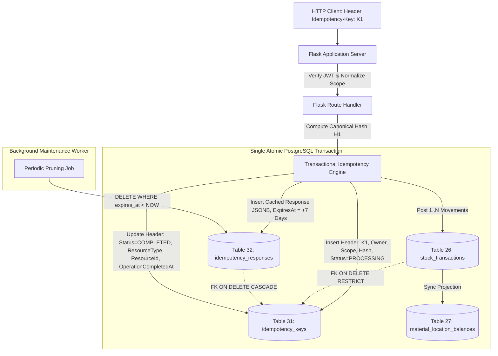

# Phase 1.8 Architectural Review & API Contract Alignment Report

**Project:** Packing Material Inventory & BOM Management System  
**Review Version:** 1.8.0  
**Phase:** 1.8 — Final API Contract, Route Registry, and Idempotency Alignment Gate  
**Date:** 2026-10-14  
**Author:** Senior API Architect & PostgreSQL Transaction Security Engineer  
**Status:** COMPLETE — Final Pre-Migration Consistency Gate Verified (Zero Database/Code Executions)  

---

## Executive Summary

Phase 1.8 establishes absolute consistency between the technical architecture specification (`SYSTEM_DESIGN.md`), OpenAPI contract (`API_CONTRACT.yaml`), architectural decision records (`ARCHITECTURE_DECISIONS.md`), quality assurance suite (`TEST_PLAN.md`), and secondary product requirements documents. 

Prior to Phase 1.8, critical discrepancies existed across the codebase documentation:
1. **Route Registry Contradictions:** Divergent plural versus singular endpoint paths existed between `SYSTEM_DESIGN.md` §2.3 and `API_CONTRACT.yaml` (e.g., `/stock/transfers` vs `/stock/transfer`, `/stock/issues` vs `/stock/issue-to-worker`, `/stock/returns` vs `/stock/return-from-worker`, `/stock/quarantine` vs `/stock/damage-quarantine`, `/stock/scrap` vs `/stock/scrap-disposal`, `/stock/purchase-returns` vs `/stock/purchase-return`, `/packing-jobs/{id}/revisions` vs `/packing-jobs/{id}/revise-quantity`, `/closings/submit` vs `/closings`).
2. **Channel Ownership Conflation:** Master catalog entities (`material_categories`, `materials`) were mistakenly declared under Flask API routes, conflicting with the established hybrid architecture where low-risk master CRUD is served directly via Supabase PostgREST under Row Level Security (RLS) and database integrity triggers.
3. **Fragmented Idempotency Policy:** State-changing Flask operations had inconsistent idempotency requirements (e.g., master BOM and purchase order creation were labeled "Optional"), exposing non-stock mutating workflows to duplicate submissions.
4. **Incomplete Expired-Response Recovery Contract:** While HTTP 410 (`IDEMPOTENCY_RESPONSE_EXPIRED`) instructed clients to query completed entity state via GET using the returned `resource_type` and `resource_id`, the Flask API contract lacked explicit detail GET endpoints for several key domain entities (`GOODS_RECEIPT`, `PRODUCTION_COMPLETION`, `DAILY_CLOSING`, `STOCK_TRANSACTION`).
5. **Misleading Timestamp Semantics:** The HTTP 410 response and idempotency tables referenced `committed_at`, falsely asserting that a physical PostgreSQL database commit timestamp could be captured prior to transaction commit.

All five discrepancies have been systematically resolved across the entire specification suite. In accordance with strict project governance, **no SQL migrations were created or executed, no live database was altered, no application code was written, and no external dependencies were installed.** All changes are documentation-only within the canonical root `docs/` directory.

---

## 1. Authoritative Route Registry & Channel Ownership Matrix

### 1.1 Channel Division Principle
The hybrid architecture strictly delineates responsibility between the client-facing data layer and the transactional application server:
- **Direct Supabase REST Channel (`/rest/v1/...`):** Governs master catalog CRUD (`material_categories`, `parties`, `products`, `vendors`, `units`, `locations`, `workers`, `materials`, `material_conversions`). Master data mutations do not accept Flask idempotency headers (`N/A`); deduplication and data integrity are enforced directly by PostgreSQL primary keys, unique indexes (`UNIQUE`), and trigger validations (e.g., `trg_prevent_canonical_unit_change`).
- **Flask REST Application Server (`/api/v1/...`):** Governs all complex multi-entity transactions, inventory movements, frozen snapshot releases, quantity revisions, production completions, shift closings, and administrative role updates.

### 1.2 Route Registry Reconciliation Table

| Business Operation | Legacy / Conflicting Route | Authoritative Canonical Route | Channel | HTTP Method | `Idempotency-Key` Required? | Authoritative Reference |
| :--- | :--- | :--- | :---: | :---: | :---: | :--- |
| **Inward Goods Receipt Posting** | `/goods-receipts/post` | `/api/v1/goods-receipts/post` | Flask | `POST` | **YES (Mandatory)** | ADR-002, ADR-023 |
| **Production Completion & Consumption**| `/production/completions` | `/api/v1/production/completions` | Flask | `POST` | **YES (Mandatory)** | ADR-010, ADR-014 |
| **Internal Stock Transfer** | `/stock/transfers` | `/api/v1/stock/transfer` | Flask | `POST` | **YES (Mandatory)** | ADR-016, ADR-029 |
| **Issue Material to Worker** | `/stock/issues` | `/api/v1/stock/issue-to-worker` | Flask | `POST` | **YES (Mandatory)** | ADR-003, ADR-029 |
| **Return Material from Worker** | `/stock/returns` | `/api/v1/stock/return-from-worker` | Flask | `POST` | **YES (Mandatory)** | ADR-003, ADR-029 |
| **Damage Quarantine Transfer** | `/stock/quarantine` | `/api/v1/stock/damage-quarantine` | Flask | `POST` | **YES (Mandatory)** | ADR-006, ADR-029 |
| **Scrap Disposal Write-Off** | `/stock/scrap` | `/api/v1/stock/scrap-disposal` | Flask | `POST` | **YES (Mandatory)** | ADR-006, ADR-029 |
| **Stock Cycle Adjustment** | `/stock/adjustments` | `/api/v1/stock/adjustments` | Flask | `POST` | **YES (Mandatory)** | ADR-002, ADR-018 |
| **Purchase Return** | `/stock/purchase-returns` | `/api/v1/stock/purchase-return` | Flask | `POST` | **YES (Mandatory)** | ADR-020, ADR-029 |
| **Create Daily Packing Plan** | `/daily-plans` | `/api/v1/daily-plans` | Flask | `POST` | **YES (Mandatory)** | ADR-015, ADR-029 |
| **Release Daily Packing Plan** | `/daily-plans/{id}/release`| `/api/v1/daily-plans/{id}/release` | Flask | `POST` | **YES (Mandatory)** | ADR-004, ADR-019 |
| **Revise Job Quantity (520 $\to$ 450)** | `/packing-jobs/{id}/revisions` | `/api/v1/packing-jobs/{id}/revise-quantity` | Flask | `POST` | **YES (Mandatory)** | ADR-016, ADR-022 |
| **Cancel Job Remainder** | `/packing-jobs/{id}/cancel`| `/api/v1/packing-jobs/{id}/cancel` | Flask | `POST` | **YES (Mandatory)** | ADR-016, ADR-029 |
| **Execute Daily Closing** | `/closings/submit` | `/api/v1/closings` | Flask | `POST` | **YES (Mandatory)** | ADR-005, ADR-015 |
| **Reopen Daily Closing** | `/closings/{id}/reopen` | `/api/v1/closings/{id}/reopen` | Flask | `POST` | **YES (Mandatory)** | ADR-005, ADR-029 |
| **Update User Profile Access** | `/admin/users/{id}/access` | `/api/v1/admin/users/{targetId}/access` | Flask | `POST` | **YES (Mandatory)** | ADR-011, ADR-021 |
| **Create Master BOM** | `/boms` | `/api/v1/boms` | Flask | `POST` | **YES (Mandatory)** | ADR-004, ADR-029 |
| **Create New BOM Version** | `/boms/{id}/new-version` | `/api/v1/boms/{id}/new-version` | Flask | `POST` | **YES (Mandatory)** | ADR-004, ADR-029 |
| **Activate BOM Version** | *(Missing from Flask)* | `/api/v1/boms/{id}/activate` | Flask | `POST` | **YES (Mandatory)** | ADR-015, ADR-029 |
| **Create Purchase Order** | *(Missing from Flask)* | `/api/v1/purchase-orders` | Flask | `POST` | **YES (Mandatory)** | PRD Mod 2, ADR-029 |
| **Direct Master CRUD (9 Tables)** | `/material-categories`, `/materials` | `/rest/v1/{table}` | PostgREST | `GET/POST/PATCH/DELETE` | **N/A** (DB Constraints) | ADR-001, ADR-009 |

---

## 2. Complete 31-Endpoint Flask API Contract Breakdown

`docs/API_CONTRACT.yaml` (v1.8.0) specifies exactly **31 endpoints** partitioned into 20 state-changing commands and 11 queries/lookups:

### 2.1 State-Changing Command Endpoints (20 POST Endpoints)
Every command requires an authenticated Supabase JWT Bearer token and a mandatory `Idempotency-Key` header:
1. `POST /api/v1/admin/users/{targetId}/access`: Admin-governed user role and status update.
2. `POST /api/v1/purchase-orders`: Purchase order creation.
3. `POST /api/v1/boms`: Master BOM recipe creation.
4. `POST /api/v1/boms/{id}/new-version`: Master BOM version increment.
5. `POST /api/v1/boms/{id}/activate`: Atomic activation of BOM version (enforces partial unique index).
6. `POST /api/v1/goods-receipts/post`: Trusted inward goods receipt posting with dual-unit normalization.
7. `POST /api/v1/stock/issue-to-worker`: Material issuance to operator custody location.
8. `POST /api/v1/stock/return-from-worker`: Return of unused materials from operator custody.
9. `POST /api/v1/stock/transfer`: Internal stock movement between store shelves, buffers, and bays.
10. `POST /api/v1/stock/damage-quarantine`: Segregation of damaged goods to quarantine leaf location.
11. `POST /api/v1/stock/scrap-disposal`: Permanent disposal write-off originating from quarantine.
12. `POST /api/v1/stock/adjustments`: Cycle count and physical audit adjustments with supervisor sign-off.
13. `POST /api/v1/stock/purchase-return`: Return of rejected or surplus materials to vendor.
14. `POST /api/v1/daily-plans`: Creation of daily packing plan and job draft headers.
15. `POST /api/v1/daily-plans/{id}/release`: Atomic release of daily plan, freezing immutable snapshots and locking reservations.
16. `POST /api/v1/packing-jobs/{id}/revise-quantity`: In-shift quantity revision enforcing completed-quantity floor.
17. `POST /api/v1/packing-jobs/{id}/cancel`: Cancellation of job remainder and reservation release.
18. `POST /api/v1/production/completions`: Finished packaging output recording, theoretical backflush, and variance calculation.
19. `POST /api/v1/closings`: Shift/daily closing execution and discrepancy reconciliation.
20. `POST /api/v1/closings/{id}/reopen`: Admin-only reopening of closed operational periods.

### 2.2 System Queries & Aggregated Views (3 GET Endpoints)
1. `GET /api/v1/health`: Unauthenticated service liveness probe.
2. `GET /api/v1/stock/balances`: Aggregated on-hand, reserved, and available stock balances across location nodes.
3. `GET /api/v1/stock/ledger`: Filterable, paginated audit view of immutable stock transaction movements.

### 2.3 Authorized Detail Lookups & Expired-Response Recovery Endpoints (8 GET Endpoints)
These 8 endpoints correspond 1:1 with the domain entities returned in `idempotency_keys.resource_type`:
1. `GET /api/v1/goods-receipts/{id}` $\iff$ `resource_type = 'GOODS_RECEIPT'`
2. `GET /api/v1/production/completions/{id}` $\iff$ `resource_type = 'PRODUCTION_COMPLETION'`
3. `GET /api/v1/stock/transactions/{id}` $\iff$ `resource_type = 'STOCK_TRANSACTION'`
4. `GET /api/v1/purchase-orders/{id}` $\iff$ `resource_type = 'PURCHASE_ORDER'`
5. `GET /api/v1/boms/{id}` $\iff$ `resource_type = 'BOM'`
6. `GET /api/v1/daily-plans/{id}` $\iff$ `resource_type = 'DAILY_PLAN'`
7. `GET /api/v1/packing-jobs/{id}` $\iff$ `resource_type = 'PACKING_JOB'`
8. `GET /api/v1/closings/{id}` $\iff$ `resource_type = 'DAILY_CLOSING'`

---

## 3. Unified Idempotency Policy & Recovery Workflow

### 3.1 Strict Key Format & Request Scope Binding
- **Key Header:** `Idempotency-Key` (ASCII string, length 16–128 characters matching `^[A-Za-z0-9_\-\.:]{16,128}$`).
- **Owner Scope:** Extracted exclusively from the verified JWT `sub` claim (`auth.uid()`).
- **Operation Scope:** Server-normalized `METHOD:/route/template` in UPPERCASE (e.g. `POST:/api/v1/goods-receipts/post`), never client-supplied.
- **Request Hash:** SHA-256 of the recursively sorted canonical JSON payload.

### 3.2 Two-Tier Schema Architecture


- **Tier 1: Permanent Request Identity Header (`public.idempotency_keys` - Table 31):**
  - Retained **permanently** to satisfy `ON DELETE RESTRICT` foreign keys from `stock_transactions` and `production_completions`.
  - Pruning never touches this table.
- **Tier 2: Ephemeral Response Cache (`public.idempotency_responses` - Table 32):**
  - Retained for a configurable window (default **7 days**).
  - Background pruning removes expired responses without violating foreign keys or deleting historical transactions.

### 3.3 Replay, Expiration, and Conflict Resolution Rules
1. **Identical Replay Before Expiration:** Returns cached status code and JSON body directly from `idempotency_responses`. Zero database mutations or ledger movements occur.
2. **Replay After Expiration (HTTP 410):**
   When `idempotency_responses` has been pruned, the server immediately returns **HTTP 410 Gone** with error code `IDEMPOTENCY_RESPONSE_EXPIRED`:
   ```json
   {
     "success": false,
     "error": {
       "code": "IDEMPOTENCY_RESPONSE_EXPIRED",
       "message": "The cached response for this idempotent operation has expired (retention period exceeded). The operation was completed and cannot be re-executed.",
       "resource_reference": {
         "resource_type": "GOODS_RECEIPT",
         "resource_id": "9b1deb4d-3b7d-4bad-9bdd-2b0d7b3dcb6d",
         "operation_completed_at": "2026-10-01T10:00:00Z"
       }
     }
   }
   ```
   The client uses `resource_type` and `resource_id` to fetch the entity via the corresponding authorized GET endpoint.
3. **Key Conflict & Generic Non-Disclosure (HTTP 409):**
   If an incoming request reuses an existing key but differs in `owner_id`, `operation_scope`, or `request_hash`, the server returns generic **HTTP 409 Conflict** (`IDEMPOTENCY_KEY_REUSED`) without disclosing cached payloads, user identity, or original endpoint details.
4. **Concurrent Requests:** Exclusive row locks (`FOR UPDATE`) serialize concurrent requests with the same key; exactly one transaction executes.
5. **Rollback Removes Key:** If an error occurs, PostgreSQL rolls back the transaction atomically, discarding the `idempotency_keys` row and freeing the key for clean retry.

---

## 4. Strict Timestamp Semantics (`operation_completed_at`)

Previous documentation iterations utilized `committed_at` in the HTTP 410 response schema and table definitions. 

### Why `committed_at` Was Semantically Invalid
In relational database theory and PostgreSQL transaction mechanics:
1. An active database transaction cannot read its own commit timestamp prior to physical commit.
2. Generating a timestamp inside a stored procedure via `clock_timestamp()` records the moment that specific statement executes, not the moment the write-ahead log (WAL) flushes to disk upon commit.
3. If an application fails or blocks between stored procedure execution and `COMMIT`, labeling the pre-commit timestamp as `committed_at` is semantically false.

### The Corrected Standard
The field is renamed to **`operation_completed_at`** (timestamptz, nullable):
- Populated when the transaction successfully finishes business logic execution and transitions `status = 'COMPLETED'`.
- Accurately conveys that application-level transaction preparation completed, without misrepresenting PostgreSQL physical WAL commit coordinates.
- Fully implemented across Table 31 (`idempotency_keys`), `API_CONTRACT.yaml` schemas, `SYSTEM_DESIGN.md`, and `ARCHITECTURE_DECISIONS.md` (ADR-028 & ADR-029).

---

## 5. Acceptance Scenarios & Test Strategy Updates

`docs/TEST_PLAN.md` has been updated with two dedicated acceptance scenarios verifying Phase 1.8 requirements:

### Acceptance Scenario 35: Route Registry Alignment & Mandatory Flask Idempotency Verification
- **Objective:** Verify that 100% of state-changing Flask POST commands require an `Idempotency-Key` header and reject non-compliant requests, while direct PostgREST master CRUD operates without Flask idempotency headers.
- **Test Matrix:**
  - Case A: `POST /api/v1/stock/transfer` without `Idempotency-Key` $\implies$ HTTP 400 `MISSING_IDEMPOTENCY_KEY`.
  - Case B: `POST /api/v1/boms` or `POST /api/v1/purchase-orders` without `Idempotency-Key` $\implies$ HTTP 400 `MISSING_IDEMPOTENCY_KEY`.
  - Case C: Direct PostgREST insert to `POST /rest/v1/material_categories` $\implies$ Success via PostgREST under RLS; duplicate insert rejected with HTTP 409 / PostgreSQL unique constraint violation.
- **Pass Invariant:** Zero un-idempotent or untracked state mutations occur in Flask command endpoints.

### Acceptance Scenario 36: Post-410 Authorized Resource Lookup Verification
- **Objective:** Verify that every `resource_type` returned in an HTTP 410 response maps to an authorized detail GET endpoint in the Flask API.
- **Test Matrix:** Verify all 8 resource types:
  1. `GOODS_RECEIPT` $\implies$ `GET /api/v1/goods-receipts/{id}`
  2. `PRODUCTION_COMPLETION` $\implies$ `GET /api/v1/production/completions/{id}`
  3. `STOCK_TRANSACTION` $\implies$ `GET /api/v1/stock/transactions/{id}`
  4. `PURCHASE_ORDER` $\implies$ `GET /api/v1/purchase-orders/{id}`
  5. `BOM` $\implies$ `GET /api/v1/boms/{id}`
  6. `DAILY_PLAN` $\implies$ `GET /api/v1/daily-plans/{id}`
  7. `PACKING_JOB` $\implies$ `GET /api/v1/packing-jobs/{id}`
  8. `DAILY_CLOSING` $\implies$ `GET /api/v1/closings/{id}`
- **Pass Invariant:** Authorized roles receive HTTP 200 with full entity representations; unauthorized roles receive HTTP 403 Forbidden; missing entities receive HTTP 404 Not Found.

---

## 6. Comprehensive Document Synchronization Audit

Every document in the canonical `docs/` root has been audited and synchronized to Version **1.8.0**:

| Document | Version | Audit Status | Key Changes in Phase 1.8 |
| :--- | :---: | :---: | :--- |
| `docs/API_CONTRACT.yaml` | **1.8.0** | **VERIFIED** | 31 endpoints defined; removed master PostgREST CRUD; added `POST /purchase-orders`, `POST /boms/{id}/activate`, and 8 detail GET endpoints; 219 `$ref` links 100% resolved. |
| `docs/SYSTEM_DESIGN.md` | **1.8.0** | **VERIFIED** | Section 2.1 channel ownership reconciled; Section 2.3 route matrix updated with canonical paths & mandatory idempotency; Section 2.4 added for GET recovery endpoints; Table 31 updated with `operation_completed_at`; Section 7.4 updated with correct timestamp semantics. |
| `docs/ARCHITECTURE_DECISIONS.md` | **1.8.0** | **VERIFIED** | ADR-028 updated with `operation_completed_at`; ADR-029 added covering Route Registry, 100% Mandatory Flask Idempotency, and Expired-Response Recovery. |
| `docs/TEST_PLAN.md` | **1.8.0** | **VERIFIED** | Scenario 27 updated with `operation_completed_at`; Scenarios 35 and 36 added to verify route alignment and post-410 lookups. |
| `docs/PRD.md` | **1.8.0** | **VERIFIED** | Section 4.2 updated with mandatory Flask idempotency policy, `operation_completed_at`, and authorized detail GET recovery flow. |
| `docs/MRD.md` | **1.8.0** | **VERIFIED** | Document version bumped to 1.8.0; verified consistent with physical domain taxonomy. |
| `docs/OPEN_DECISIONS.md` | **1.8.0** | **VERIFIED** | Document version bumped to 1.8.0; verified canonical document authority rules. |
| `docs/UI_UX_WALKTHROUGH.md` | **1.8.0** | **VERIFIED** | Document version bumped to 1.8.0; route references aligned with canonical paths. |
| `docs/REQUIREMENT_TRACEABILITY.md` | **1.8.0** | **VERIFIED** | Master CRUD mapped to direct PostgREST `/rest/v1/...`; job revision mapped to `/packing-jobs/{id}/revise-quantity`; Scenarios 35 & 36 and ADR-029 traced. |
| `docs/IMPLEMENTATION_PLAN.md` | **1.8.0** | **VERIFIED** | Document version bumped to 1.8.0; Phase 4 scope aligned with direct PostgREST master CRUD and Flask PO/GRN endpoints. |

### Automated Specification Validation
- **Internal Reference Validation (`scratch/test_refs.py`):**
  $$\text{Total } \$ref \text{ pointers resolved}: \mathbf{219} \quad | \quad \text{Missing } \$ref \text{ pointers}: \mathbf{0}$$
- **Full Specification Scan (`scratch/check_clean.py`):**
  Zero legacy conflicting routes (`/stock/transfers`, `/stock/issues`, `/stock/returns`, `/stock/quarantine`, `/closings/submit`) or obsolete `committed_at` references remain in active specification text.

---

## 7. Database Readiness Assessment & Phase 2 Gate Sign-Off

The system documentation has passed all pre-migration gates:
- **Table Inventory:** Authoritative table inventory locked at exactly **33 relational tables**.
- **Security Definer & RLS:** Trusted helper `get_current_user_role()` with empty search path and default-deny RLS across all 33 tables confirmed.
- **Signed Ledger & Projections:** Synchronous atomic balance projection procedures and anti-cascade foreign keys (`ON DELETE RESTRICT`) confirmed.
- **Two-Tier Idempotency:** Permanent request headers (`idempotency_keys`) and prunable responses (`idempotency_responses`) with HTTP 410 expiration semantics confirmed.
- **API Surface:** Authoritative 31-endpoint Flask REST API contract and direct PostgREST channel separation confirmed.

**Phase 1.8 is formally APPROVED and CLOSED.** The repository is 100% prepared to proceed to **Phase 2 (Database Migrations, Constraints & RLS)**.
