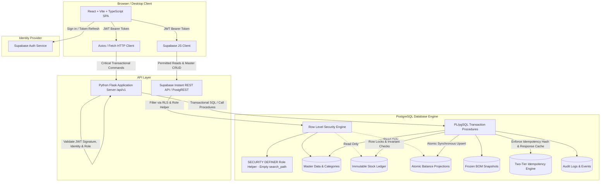
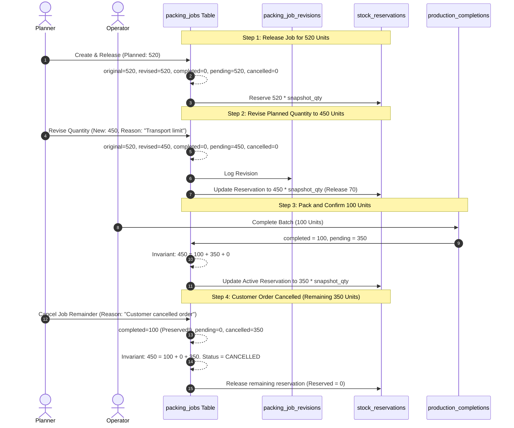
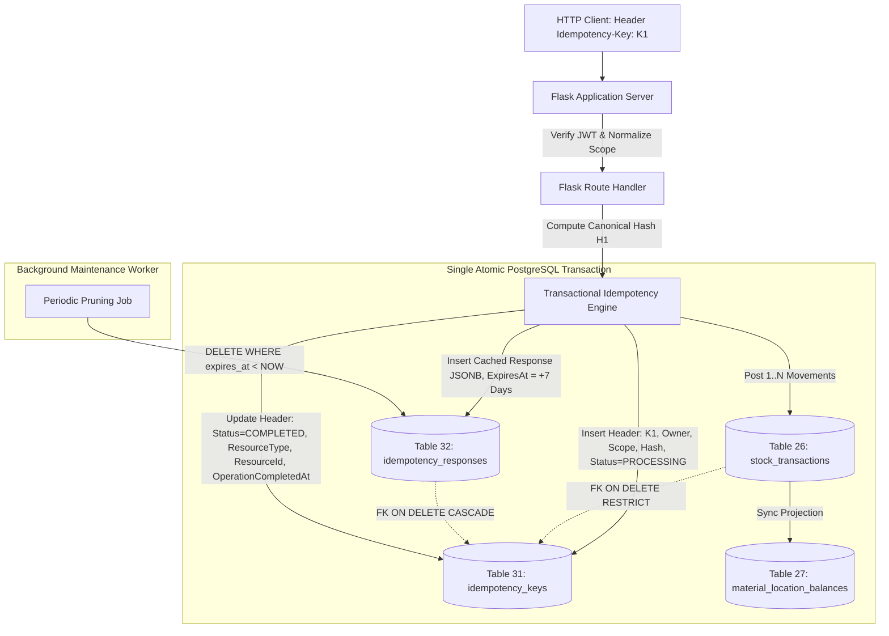

# System Design & Technical Architecture Blueprint

**Project:** Packing Material Inventory & BOM Management System  
**Document Version:** 1.10.0  
**Status:** Revised architectural blueprint — Phase 1.10 final schema/API alignment, protected operation accounting, and camelCase error reference alignment applied  
**Date:** 2026-10-19  

---

## 1. Executive Architecture Overview

The **Packing Material Inventory & BOM Management System** is engineered to eliminate shop-floor inventory discrepancies, enforce strict material traceability, and provide real-time control over finished goods packaging.

The system relies on a **hybrid architectural model**:
- **Presentation Layer:** React 19 + Vite + TypeScript Single Page Application (SPA), providing high-speed, responsive operator and planner workflows.
- **Client Data & Read API:** Supabase Instant REST API (PostgREST) backed by PostgreSQL Row Level Security (RLS) for read-intensive views, paginated lookups, reference dropdowns, and permitted low-risk master CRUD.
- **Transactional Application Server:** Python Flask REST API (`/api/v1`), responsible for complex transactional workflows, multi-entity invariants, balance verification, immutable snapshot creation, and audit orchestration.
- **Database Engine:** Supabase PostgreSQL 15+, leveraging PL/pgSQL stored procedures, row-level locks, check constraints, immutable ledgers, atomic balance projections, and foreign key constraints.
- **Authentication & Authorization:** Supabase Auth (JWT) integrated with PostgreSQL RLS via a hardened, trusted `SECURITY DEFINER` role resolution function and verified server-side in Flask decorators.



---

## 2. Component Boundaries & Security Model

### 2.1 The Critical Architectural Decision: Supabase REST vs Flask API Boundaries

A critical failure mode in hybrid Supabase architectures is creating **competing paths** to the database, where the frontend performs a client-side balance check and writes stock deductions directly via PostgREST. This causes race conditions, negative inventory, and untracked material loss.

To prevent this, the architecture establishes strict, non-overlapping operational perimeters:

| Domain | Entity / Table | Read Channel | Write Channel | Rationale |
| :--- | :--- | :--- | :--- | :--- |
| **Identity** | `profiles` | Supabase REST | Supabase Auth / Admin API | Profile creation tied to Auth triggers; admin role updates via Flask RPC (`POST /api/v1/admin/users/{targetId}/access`). |
| **Categories** | `material_categories` | Supabase REST | Supabase REST (Admin) | Data-driven categories manageable dynamically by Admin via direct PostgREST. |
| **Catalog** | `parties`, `products`, `vendors`, `units`, `locations`, `workers` | Supabase REST | Supabase REST (Admin/Planner/Storekeeper) | Permitted CRUD enforced via PostgreSQL RLS and database triggers. |
| **Materials** | `materials`, `material_conversions` | Supabase REST | Supabase REST (Admin/Storekeeper) | Master catalog CRUD via direct PostgREST; immutable canonical unit invariant and conversion rules enforced via database triggers and RLS. |
| **BOM Catalog** | `boms`, `bom_lines`, `bom_revision_events` | Supabase REST | Flask API (`/api/v1/boms/...`) | Version increments and status transitions require transactional validation. |
| **Purchasing** | `purchase_orders`, `purchase_order_lines` | Supabase REST | Flask API (`/api/v1/purchase-orders`) | Status lifecycles, numbering sequences, and revision control. |
| **Inward Receipt** | `goods_receipts`, `goods_receipt_lines` | Supabase REST | Flask API (`/api/v1/goods-receipts/post`) | **Direct client write denied.** Posting inward receipt atomically mutates the stock ledger. |
| **Planning** | `daily_plans`, `packing_jobs` | Supabase REST | Flask API (`/api/v1/daily-plans/...`) | Creation of daily plans, jobs, and frozen snapshots must be atomic. |
| **Job Snapshots**| `packing_job_bom_snapshots`, `...lines` | Supabase REST | Flask API (`/api/v1/...`) | **Direct client write denied.** Snapshots are immutable once released. |
| **Job Lifecycle**| `packing_job_revisions`, `events` | Supabase REST | Flask API (`/api/v1/packing-jobs/{id}/...`) | Revisions (520→450) and cancellations require recalculating reservations and custody. |
| **Inventory** | `stock_transactions`, `stock_reservations` | Supabase REST | Flask API (`/api/v1/stock/...`) | **Direct client write denied.** Enforces row locks, balance constraints, and append-only ledger. |
| **Projections** | `material_location_balances` | Supabase REST | DB Stored Procedures Only | **Direct client write denied.** Maintained atomically by ledger procedures. |
| **Idempotency Header** | `idempotency_keys` | **Denied to PostgREST** | Trusted Transactional DB Procedures / Flask API | **Direct client write and read denied.** Immutable request identity header; permanent audit trail. |
| **Response Cache** | `idempotency_responses` | **Denied to PostgREST** | Trusted Transactional DB Procedures / Flask API | **Direct client write and read denied.** Ephemeral response cache with configurable retention; prunable. |
| **Production** | `production_completions`, `material_consumption_records` | Supabase REST | Flask API (`/api/v1/production/completions`) | Atomic completion of goods, consumption deduction, and variance recording. |
| **Reconciliations**| `stock_adjustments`, `daily_closings` | Supabase REST | Flask API (`/api/v1/stock/adjustments`, `/api/v1/closings/...`) | Approvals, lockouts, variance reconciliation, and audit log commits. |
| **Compliance** | `audit_logs` | Supabase REST (Admin) | Flask API / DB Triggers | **Direct client write denied.** Immutable audit trail. |

### 2.2 Security & Credential Isolation
1. **Frontend Isolation:** The React client receives ONLY the Supabase `publishable/anon` key. The Supabase `service_role` secret is **NEVER** bundled into client code or environment variables.
2. **Server-Side Authorization:** Flask validates the JWT on every request using `PyJWT` against Supabase's signing secret or public JWKS endpoint. Client-supplied headers or body claims claiming identity or role are strictly ignored; identity is extracted exclusively from the validated `sub` claim.
3. **Database Guardrails:** PostgreSQL RLS policies on all transaction, snapshot, projection, idempotency, and closing tables strictly evaluate `USING (false)` for `INSERT`, `UPDATE`, and `DELETE` for the `anon` and `authenticated` roles. Only database connections utilizing elevated privileges or dedicated stored procedures callable by Flask can post ledger movements.
4. **OpenAPI Security Scheme (`SupabaseJWT`):** The canonical `API_CONTRACT.yaml` (v1.10.0) declares a global `security` policy using the `SupabaseJWT` HTTP Bearer scheme (`components.securitySchemes.SupabaseJWT`, type `http`, scheme `bearer`, bearerFormat `JWT`). The API comprises 33 operations (20 POST commands, 13 GET queries). Exactly 32 operations are protected and require a valid Bearer token; the sole exception is `GET /health` which explicitly overrides with `security: []` (unauthenticated). Failed authentication returns HTTP 401 via the reusable `UnauthorizedResponse` envelope; insufficient role authorization returns HTTP 403 via the `ForbiddenResponse` envelope.

### 2.3 Route-by-Route Write-Channel & Idempotency Matrix

To eliminate any ambiguity regarding which channels handle mutations, where validation occurs, and how duplicate writes are prevented, the following matrix governs every write operation in the system.

**Unified Idempotency Policy:**
- **Flask API State-Changing Commands (POST):** 100% of state-changing operations under `/api/v1` **mandatorily** require the `Idempotency-Key` HTTP header (16–128 ASCII chars matching `^[A-Za-z0-9_\-\.:]{16,128}$`). Missing or malformed keys are rejected with HTTP 400.
- **Direct PostgREST Master CRUD:** PostgREST master operations do not accept Flask idempotency headers (`N/A`). Duplicate writes are strictly prevented via PostgreSQL primary keys and unique constraints (`UNIQUE` indexes), enforced by the database engine.

| Operation / Business Action | HTTP Route / PostgREST Target | Channel | `Idempotency-Key` Required | Duplicate Prevention Mechanism | Authorization & Validation Locus | Creates Stock / Historical Records? |
| :--- | :--- | :--- | :---: | :--- | :--- | :---: |
| **Inward Goods Receipt Posting** | `POST /api/v1/goods-receipts/post` | Flask API | **YES** | Transactional `idempotency_keys` + `idempotency_responses` + multi-row sequence | Flask verifies JWT & role (`STOREKEEPER`, `ADMIN`), validates units/evidence, invokes `fn_post_goods_receipt` | **YES** (`goods_receipts`, `goods_receipt_lines`, `stock_transactions`, `material_location_balances`) |
| **Production Completion & Consumption** | `POST /api/v1/production/completions` | Flask API | **YES** | Transactional `idempotency_keys` + `idempotency_responses` + multi-row sequence | Flask verifies JWT & role (`OPERATOR`, `PLANNER`, `ADMIN`), verifies released job, executes atomic completion procedure | **YES** (`production_completions`, `material_consumption_records`, `stock_transactions`, `balances`) |
| **Internal Stock Transfer** | `POST /api/v1/stock/transfer` | Flask API | **YES** | Transactional `idempotency_keys` + `idempotency_responses` | Flask verifies JWT & role (`STOREKEEPER`, `ADMIN`), validates active leaf locations, sufficient balance | **YES** (`stock_transactions` TRANSFER, `material_location_balances`) |
| **Issue to Worker Custody** | `POST /api/v1/stock/issue-to-worker` | Flask API | **YES** | Transactional `idempotency_keys` + `idempotency_responses` | Flask verifies JWT & role (`STOREKEEPER`, `PLANNER`, `ADMIN`), validates active job/worker, sufficient balance | **YES** (`stock_transactions` ISSUE_TO_WORKER, `material_location_balances`) |
| **Return from Worker Custody** | `POST /api/v1/stock/return-from-worker` | Flask API | **YES** | Transactional `idempotency_keys` + `idempotency_responses` | Flask verifies JWT & role (`STOREKEEPER`, `OPERATOR`, `ADMIN`), verifies worker custody balance $\ge$ return qty | **YES** (`stock_transactions` RETURN_FROM_WORKER, `material_location_balances`) |
| **Damage Quarantine Transfer** | `POST /api/v1/stock/damage-quarantine` | Flask API | **YES** | Transactional `idempotency_keys` + `idempotency_responses` | Flask verifies JWT & role (`STOREKEEPER`, `ADMIN`), validates leaf locations & mandatory reason | **YES** (`stock_transactions` DAMAGE_QUARANTINE, `material_location_balances`) |
| **Scrap Disposal Write-off** | `POST /api/v1/stock/scrap-disposal` | Flask API | **YES** | Transactional `idempotency_keys` + `idempotency_responses` | Flask verifies JWT & role (`ADMIN`, `STOREKEEPER`), verifies source is `DAMAGE_QUARANTINE` leaf | **YES** (`stock_transactions` SCRAP_DISPOSAL, `material_location_balances`) |
| **Stock Cycle Adjustment** | `POST /api/v1/stock/adjustments` | Flask API | **YES** | Transactional `idempotency_keys` + `idempotency_responses` | Flask verifies JWT & role (`ADMIN`, `STOREKEEPER`), requires supervisor signoff | **YES** (`stock_adjustments`, `stock_transactions` STOCK_ADJUSTMENT, `material_location_balances`) |
| **Purchase Return** | `POST /api/v1/stock/purchase-return` | Flask API | **YES** | Transactional `idempotency_keys` + `idempotency_responses` | Flask verifies JWT & role (`STOREKEEPER`, `ADMIN`), verifies original GRN & mandatory reason | **YES** (`stock_transactions` PURCHASE_RETURN, `material_location_balances`) |
| **Daily Packing Plan Creation** | `POST /api/v1/daily-plans` | Flask API | **YES** | Transactional `idempotency_keys` + `idempotency_responses` | Flask verifies JWT & role (`PLANNER`, `ADMIN`), validates calendar date & shift code | **NO** (Creates `daily_plans` & `packing_jobs` in `DRAFT`) |
| **Release Daily Packing Plan** | `POST /api/v1/daily-plans/{id}/release` | Flask API | **YES** | Transactional `idempotency_keys` + `idempotency_responses` | Flask verifies JWT & role (`PLANNER`, `ADMIN`), validates non-empty snapshot lines, creates reservations | **YES** (`packing_job_bom_snapshots`, `snapshot_lines`, `stock_reservations`) |
| **Job Quantity Revision (520$\to$450)** | `POST /api/v1/packing-jobs/{id}/revise-quantity` | Flask API | **YES** | Transactional `idempotency_keys` + `idempotency_responses` | Flask verifies JWT & role (`PLANNER`, `ADMIN`), verifies floor (`revised >= completed`), adjusts reservations | **YES** (`packing_job_revisions`, updates `stock_reservations`) |
| **Job Remainder Cancellation** | `POST /api/v1/packing-jobs/{id}/cancel` | Flask API | **YES** | Transactional `idempotency_keys` + `idempotency_responses` | Flask verifies JWT & role (`PLANNER`, `ADMIN`), zeroes pending qty, releases reservations | **YES** (`packing_job_events`, releases `stock_reservations`) |
| **Execute Daily Closing** | `POST /api/v1/closings` | Flask API | **YES** | Transactional `idempotency_keys` + `idempotency_responses` + DB `UNIQUE(daily_plan_id)` | Flask verifies JWT & role (`STOREKEEPER`, `ADMIN`), composite shift FK validation, discrepancy checks | **YES** (`daily_closings` locked) |
| **Reopen Daily Closing** | `POST /api/v1/closings/{id}/reopen` | Flask API | **YES** | Transactional `idempotency_keys` + `idempotency_responses` | Flask verifies JWT & role (`ADMIN` ONLY), mandatory justification note | **YES** (`audit_logs`, updates `daily_closings`) |
| **Update User Profile Access** | `POST /api/v1/admin/users/{targetId}/access` | Flask API | **YES** | Transactional `idempotency_keys` + `idempotency_responses` | Flask forwards JWT to `admin_update_profile_access` RPC; verifies caller `auth.uid()` is active ADMIN | **NO** (`profiles` role/status, `audit_logs`) |
| **Create Master BOM** | `POST /api/v1/boms` | Flask API | **YES** | Transactional `idempotency_keys` + `idempotency_responses` + DB `UNIQUE NULLS NOT DISTINCT (product_id, party_id, packing_variant_name, version_number)` | Flask verifies JWT & role (`PLANNER`, `ADMIN`), validates line materials & units | **NO** (`boms`, `bom_lines`) |
| **New Master BOM Version** | `POST /api/v1/boms/{id}/new-version` | Flask API | **YES** | Transactional `idempotency_keys` + `idempotency_responses` + DB version sequence increment | Flask verifies JWT & role (`PLANNER`, `ADMIN`) | **NO** (`boms`, `bom_lines`, `bom_revision_events`) |
| **Activate Master BOM Version** | `POST /api/v1/boms/{id}/activate` | Flask API | **YES** | Transactional `idempotency_keys` + `idempotency_responses` + Partial Unique Index `idx_boms_single_active_version` | Flask verifies JWT & role (`PLANNER`, `ADMIN`) | **NO** (`boms` status update) |
| **Create Purchase Order** | `POST /api/v1/purchase-orders` | Flask API | **YES** | Transactional `idempotency_keys` + `idempotency_responses` + DB `UNIQUE(po_number)` | Flask verifies JWT & role (`STOREKEEPER`, `ADMIN`) | **NO** (Does NOT increase stock) |
| **Direct Master CRUD (Categories)** | `material_categories` | PostgREST | **N/A** | DB Unique `UNIQUE(category_code)`; RLS `role = 'ADMIN'` | PostgreSQL RLS Engine + Table Constraints | **NO** (Master data only) |
| **Direct Master CRUD (Parties)** | `parties` | PostgREST | **N/A** | DB Unique `UNIQUE(party_code)`; RLS `role IN ('ADMIN', 'PLANNER')` | PostgreSQL RLS Engine + Table Constraints | **NO** (Master data only) |
| **Direct Master CRUD (Products)** | `products` | PostgREST | **N/A** | DB Unique `UNIQUE(sku)`; RLS `role IN ('ADMIN', 'PLANNER')` | PostgreSQL RLS Engine + Table Constraints | **NO** (Master data only) |
| **Direct Master CRUD (Vendors)** | `vendors` | PostgREST | **N/A** | DB Unique `UNIQUE(vendor_code)`; RLS `role IN ('ADMIN', 'STOREKEEPER')` | PostgreSQL RLS Engine + Table Constraints | **NO** (Master data only) |
| **Direct Master CRUD (Units)** | `units` | PostgREST | **N/A** | DB Unique `UNIQUE(unit_code)`; RLS `role = 'ADMIN'` | PostgreSQL RLS Engine + Table Constraints | **NO** (Master reference only) |
| **Direct Master CRUD (Locations)**| `locations` | PostgREST | **N/A** | DB Unique `UNIQUE(location_code)`; RLS `role IN ('ADMIN', 'STOREKEEPER')` + topology trigger | PostgreSQL RLS Engine + Topology Trigger | **NO** (Master topology only) |
| **Direct Master CRUD (Workers)** | `workers` | PostgREST | **N/A** | DB Unique `UNIQUE(worker_code)`; RLS `role IN ('ADMIN', 'PLANNER')` | PostgreSQL RLS Engine + Table Constraints | **NO** (Master data only) |
| **Direct Master CRUD (Materials)**| `materials` | PostgREST | **N/A** | DB Unique `UNIQUE(item_code)`; RLS `role IN ('ADMIN', 'STOREKEEPER')` + canonical-unit immutability trigger | PostgreSQL RLS Engine + Table Triggers & Constraints | **NO** (Master catalog only) |
| **Direct Master CRUD (Material Conversions)**| `material_conversions` | PostgREST | **N/A** | DB Constraint `CHECK (from_unit_id != to_unit_id)`; RLS `role IN ('ADMIN', 'STOREKEEPER')` | PostgreSQL RLS Engine + Table Constraints | **NO** (Master reference only) |

### 2.4 Authoritative Flask Query & Detail Recovery Endpoints (GET)

In addition to state-changing commands, the Flask application server provides **13 authoritative read endpoints** (3 system/aggregated queries + 10 authorized resource detail and recovery endpoints):
- **System Health:** `GET /api/v1/health` (Unauthenticated service liveness probe).
- **Aggregated Inventory Views:**
  - `GET /api/v1/stock/balances` (Real-time material balances across locations, verified by RLS/role).
  - `GET /api/v1/stock/ledger` (Paginated, filterable immutable transaction history).
- **Authorized Resource Detail & Expired-Response Recovery Endpoints (10):**
  When a retried request receives HTTP 410 (`IDEMPOTENCY_RESPONSE_EXPIRED`), the client uses the returned `resourceReference.resourceType` and `resourceReference.resourceId` to fetch the completed entity details directly through these authorized GET routes. Every value in the `resourceType` enum maps to exactly one Flask GET route:
  - `GET /api/v1/goods-receipts/{id}` (`resourceType = 'GOODS_RECEIPT'`)
  - `GET /api/v1/production/completions/{id}` (`resourceType = 'PRODUCTION_COMPLETION'`)
  - `GET /api/v1/stock/transactions/{id}` (`resourceType = 'STOCK_TRANSACTION'`)
  - `GET /api/v1/stock/adjustments/{id}` (`resourceType = 'STOCK_ADJUSTMENT'`)
  - `GET /api/v1/purchase-orders/{id}` (`resourceType = 'PURCHASE_ORDER'`)
  - `GET /api/v1/boms/{id}` (`resourceType = 'BOM'`)
  - `GET /api/v1/daily-plans/{id}` (`resourceType = 'DAILY_PLAN'`)
  - `GET /api/v1/packing-jobs/{id}` (`resourceType = 'PACKING_JOB'`)
  - `GET /api/v1/closings/{id}` (`resourceType = 'DAILY_CLOSING'`)
  - `GET /api/v1/admin/users/{targetId}` (`resourceType = 'PROFILE'`)

**Total Flask endpoints: 33** (20 POST state-changing commands + 13 GET queries/lookups). Exactly 32 operations are protected and require a valid Bearer token, while 1 operation (`GET /health`) is explicitly unauthenticated.

---

## 3. Conceptual & Normalized Database Schema

The database consists of **33 core relational tables**, fully normalized to 3NF, utilizing UUID primary keys, check constraints, restrictive foreign keys (preventing cascade deletions of historical data), and performance indexes.

### Table 1: `profiles`
- **Purpose:** Extends `auth.users` with application RBAC roles, contact metadata, and active status.
- **Primary Key:** `id` (UUID, references `auth.users(id)` ON DELETE RESTRICT).
- **Columns:** `email` (text, not null), `full_name` (text, not null), `role` (text, not null, check `role IN ('ADMIN', 'STOREKEEPER', 'PLANNER', 'OPERATOR', 'VIEWER')`), `is_active` (boolean, default true), `created_at` (timestamptz), `updated_at` (timestamptz).
- **Security Triggers:** `trg_protect_profile_role` (fail-closed trigger blocking non-admin users from altering `role` or `is_active` using `IS DISTINCT FROM 'ADMIN'`).
- **Constraints & Indexes:** `UNIQUE(email)`, Index on `role`.
- **Classification:** Source-of-truth, editable.

### Table 2: `material_categories`
- **Purpose:** Data-driven categorization of packaging materials, allowing administrators to add new categories without code or schema changes.
- **Primary Key:** `id` (UUID).
- **Columns:** `category_code` (text, not null), `category_name` (text, not null), `description` (text), `is_active` (boolean, default true), `created_at` (timestamptz), `updated_at` (timestamptz).
- **Constraints & Indexes:** `UNIQUE(category_code)`, Index on `category_name`.
- **Classification:** Source-of-truth, editable.

### Table 3: `parties`
- **Purpose:** Stores customer/party accounts for whom packing jobs and custom BOMs are defined.
- **Primary Key:** `id` (UUID).
- **Columns:** `party_code` (text, not null), `party_name` (text, not null), `contact_phone` (text), `contact_email` (text), `billing_address` (text), `shipping_address` (text), `is_active` (boolean, default true), `created_at` (timestamptz), `updated_at` (timestamptz).
- **Constraints & Indexes:** `UNIQUE(party_code)`, Index on `party_name`.
- **Classification:** Source-of-truth, editable.

### Table 4: `products`
- **Purpose:** Catalog of finished goods produced and packed on the production line.
- **Primary Key:** `id` (UUID).
- **Columns:** `sku` (text, not null), `product_name` (text, not null), `description` (text), `default_party_id` (UUID, nullable, FK `parties(id)` ON DELETE RESTRICT), `is_active` (boolean, default true), `created_at` (timestamptz), `updated_at` (timestamptz).
- **Constraints & Indexes:** `UNIQUE(sku)`, Index on `product_name`.
- **Classification:** Source-of-truth, editable.

### Table 5: `vendors`
- **Purpose:** Suppliers providing raw packing materials (cartons, poly bags, screws, tape, foam).
- **Primary Key:** `id` (UUID).
- **Columns:** `vendor_code` (text, not null), `vendor_name` (text, not null), `contact_person` (text), `phone` (text), `email` (text), `tax_id_gstin` (text), `address` (text), `payment_terms` (text), `is_active` (boolean, default true), `created_at` (timestamptz), `updated_at` (timestamptz).
- **Constraints & Indexes:** `UNIQUE(vendor_code)`, Index on `vendor_name`.
- **Classification:** Source-of-truth, editable.

### Table 6: `units`
- **Purpose:** Measurement units definition (KG, G, PCS, BOX, ROLL, METER).
- **Primary Key:** `id` (UUID).
- **Columns:** `unit_code` (text, not null), `unit_name` (text, not null), `is_fractional` (boolean, not null), `created_at` (timestamptz).
- **Constraints & Indexes:** `UNIQUE(unit_code)`.
- **Classification:** Source-of-truth, immutable/append-only.

### Table 7: `materials`
- **Purpose:** Master catalog of packing materials, specifications, canonical inventory units, and category links.
- **Primary Key:** `id` (UUID).
- **Columns:** `item_code` (text, not null), `material_name` (text, not null), `category_id` (UUID, not null, FK `material_categories(id)` ON DELETE RESTRICT), `canonical_unit_id` (UUID, not null, FK `units(id)` ON DELETE RESTRICT), `thickness_gauge` (numeric), `width_mm` (numeric), `length_mm` (numeric), `height_mm` (numeric), `diameter_thread_spec` (text), `additional_specs` (jsonb, default '{}'::jsonb), `min_stock_alert_level` (numeric, default 0), `is_active` (boolean, default true), `created_at` (timestamptz), `updated_at` (timestamptz).
- **Canonical-unit immutability:** A `BEFORE UPDATE` trigger must reject a change to `canonical_unit_id` if the material has any `stock_transactions`, `stock_reservations` (including released/fulfilled history), or released `packing_job_bom_snapshot_lines`. This is a cross-table rule and cannot be implemented as a CHECK. It protects historical ledger units, balance projections, reservations, and frozen BOM quantities from reinterpretation. Before any activity, a normal correction is allowed. After activity, the only supported correction is to preserve/deactivate the original variant as appropriate and create a replacement material variant with the correct canonical unit; remaining stock is handled through auditable operational movements, not by reuniting history. No stock-conversion/rebase procedure is in scope for this design.
- **Constraints & Indexes:** `UNIQUE(item_code)`, Index on `(category_id, is_active)`. Check `min_stock_alert_level >= 0`. Check `jsonb_typeof(additional_specs) = 'object'`.
- **Classification:** Source-of-truth, soft-deletable via `is_active`.

### Table 8: `material_conversions`
- **Purpose:** Material-specific unit conversion rules distinguishing mathematically exact conversions from calibrated estimates.
- **Primary Key:** `id` (UUID).
- **Columns:** `material_id` (UUID, not null, FK `materials(id)` ON DELETE RESTRICT), `from_unit_id` (UUID, not null, FK `units(id)` ON DELETE RESTRICT), `to_unit_id` (UUID, not null, FK `units(id)` ON DELETE RESTRICT), `conversion_factor` (numeric, not null, check `conversion_factor > 0`), `conversion_type` (text, not null, check `conversion_type IN ('EXACT', 'ESTIMATED')`), `provenance_note` (text, not null), `effective_from` (timestamptz, not null), `effective_to` (timestamptz, nullable), `created_by` (UUID, FK `profiles(id)` ON DELETE RESTRICT), `created_at` (timestamptz).
- **Constraints & Indexes:** `CHECK (from_unit_id != to_unit_id)`, Index on `(material_id, from_unit_id, to_unit_id, effective_from)`. A rule row is append-only: superseding a rule closes its effective period and adds a new rule ID; posted rows retain the selected rule ID and frozen factor rather than resolving the currently effective rule later.
- **Classification:** Versioned / Audited / Append-only.

### Table 9: `locations`
- **Purpose:** Hierarchical storage topology (warehouses, zones, shelves, buffer bays, damage quarantine, dispatch, and virtual worker custody nodes).
- **Primary Key:** `id` (UUID).
- **Columns:** `location_code` (text, not null), `location_name` (text, not null), `location_type` (text, not null, check `location_type IN ('STORE_SHELF', 'RECEIVING_BAY', 'SHOP_FLOOR_BUFFER', 'WORKER_CUSTODY', 'DAMAGE_QUARANTINE', 'DISPATCH')`), `parent_location_id` (UUID, nullable, FK `locations(id)` ON DELETE RESTRICT), `is_leaf` (boolean, not null, default true), `is_active` (boolean, default true), `created_at` (timestamptz).
- **Hierarchy Invariant:** Transactions are strictly recorded against leaf locations (`is_leaf = true`). Parent nodes (`is_leaf = false`) represent organizational grouping containers and can NEVER hold direct ledger balances.
- **Constraints & Indexes:** `UNIQUE(location_code)`, Index on `parent_location_id`.
- **Classification:** Source-of-truth, hierarchical tree.

### Table 10: `workers`
- **Purpose:** Shop-floor packing operators who take physical custody of materials and pack finished goods.
- **Primary Key:** `id` (UUID).
- **Columns:** `worker_code` (text, not null), `full_name` (text, not null), `department` (text), `assigned_location_id` (UUID, not null, FK `locations(id)` ON DELETE RESTRICT), `is_active` (boolean, default true), `created_at` (timestamptz), `updated_at` (timestamptz).
- **Constraints & Indexes:** `UNIQUE(worker_code)`, `UNIQUE(assigned_location_id)`.
- **Classification:** Source-of-truth, editable.

### Table 11: `boms`
- **Purpose:** Bill of Materials header, versioned recipe defining standard packing requirements per unit of finished product.
- **Primary Key:** `id` (UUID).
- **Columns:** `bom_code` (text, not null), `product_id` (UUID, not null, FK `products(id)` ON DELETE RESTRICT), `party_id` (UUID, nullable, FK `parties(id)` ON DELETE RESTRICT), `packing_variant_name` (text, not null), `version_number` (integer, not null, default 1), `status` (text, not null, check `status IN ('DRAFT', 'ACTIVE', 'SUPERSEDED', 'ARCHIVED')`), `notes` (text), `created_by` (UUID, FK `profiles(id)` ON DELETE RESTRICT), `created_at` (timestamptz), `updated_at` (timestamptz).
- **Constraints & Indexes:**
  - `UNIQUE NULLS NOT DISTINCT (product_id, party_id, packing_variant_name, version_number)`
  - Partial Unique Index (At Most One Active Version Per Recipe Key):
    `CREATE UNIQUE INDEX idx_boms_single_active_version ON boms (product_id, party_id, packing_variant_name) NULLS NOT DISTINCT WHERE (status = 'ACTIVE');`
  - Index on `(product_id, status)`.
- **Classification:** Versioned entity.

### Table 12: `bom_lines`
- **Purpose:** Detail lines of a BOM specifying materials and quantities per 1 unit of finished product.
- **Primary Key:** `id` (UUID).
- **Columns:** `bom_id` (UUID, not null, FK `boms(id)` ON DELETE RESTRICT), `material_id` (UUID, not null, FK `materials(id)` ON DELETE RESTRICT), `quantity_per_unit` (numeric, not null, check `quantity_per_unit > 0`), `unit_id` (UUID, not null, FK `units(id)` ON DELETE RESTRICT), `is_optional` (boolean, default false), `notes` (text).
- **Immutability Invariant:** Cascade deletion is prohibited. Draft BOM lines may be modified/removed only while `boms.status = 'DRAFT'`. Once `ACTIVE`, lines are permanently locked.
- **Constraints & Indexes:** `UNIQUE(bom_id, material_id)`.
- **Classification:** Dependent versioned lines.

### Table 13: `bom_revision_events`
- **Purpose:** Immutable audit record documenting why a new BOM version was released and who approved it.
- **Primary Key:** `id` (UUID).
- **Columns:** `bom_id` (UUID, not null, FK `boms(id)` ON DELETE RESTRICT), `previous_bom_id` (UUID, nullable, FK `boms(id)` ON DELETE RESTRICT), `revision_reason` (text, not null), `changed_by` (UUID, not null, FK `profiles(id)` ON DELETE RESTRICT), `created_at` (timestamptz).
- **Classification:** Append-only audit.

### Table 14: `purchase_orders`
- **Purpose:** Vendor purchase order tracking ordered material quantities and commercial terms.
- **Primary Key:** `id` (UUID).
- **Columns:** `po_number` (text, not null), `vendor_id` (UUID, not null, FK `vendors(id)` ON DELETE RESTRICT), `order_date` (date, not null), `expected_delivery_date` (date), `status` (text, not null, check `status IN ('DRAFT', 'APPROVED', 'PARTIALLY_RECEIVED', 'COMPLETED', 'CANCELLED')`), `remarks` (text), `created_by` (UUID, FK `profiles(id)` ON DELETE RESTRICT), `created_at` (timestamptz), `updated_at` (timestamptz).
- **Constraints & Indexes:** `UNIQUE(po_number)`, Index on `(vendor_id, status)`.
- **Classification:** Source-of-truth, stateful.

### Table 15: `purchase_order_lines`
- **Purpose:** Line items of a purchase order.
- **Primary Key:** `id` (UUID).
- **Columns:** `po_id` (UUID, not null, FK `purchase_orders(id)` ON DELETE RESTRICT), `material_id` (UUID, not null, FK `materials(id)` ON DELETE RESTRICT), `ordered_quantity` (numeric, not null, check `ordered_quantity > 0`), `unit_id` (UUID, not null, FK `units(id)` ON DELETE RESTRICT), `received_quantity` (numeric, not null, default 0, check `received_quantity >= 0`), `created_at` (timestamptz).
- **Constraints & Indexes:** `UNIQUE(po_id, material_id)`.
- **Classification:** Source-of-truth, stateful.

### Table 16: `goods_receipts`
- **Purpose:** Inward receipt document recording physical delivery of packing materials at warehouse dock.
- **Primary Key:** `id` (UUID).
- **Columns:** `grn_number` (text, not null), `vendor_id` (UUID, not null, FK `vendors(id)` ON DELETE RESTRICT), `po_id` (UUID, nullable, FK `purchase_orders(id)` ON DELETE RESTRICT), `invoice_number` (text, not null), `invoice_date` (date, not null), `received_date` (date, not null), `destination_location_id` (UUID, not null, FK `locations(id)` ON DELETE RESTRICT), `status` (text, not null, check `status IN ('DRAFT', 'POSTED', 'CANCELLED')`), `remarks` (text), `posted_by` (UUID, nullable, FK `profiles(id)` ON DELETE RESTRICT), `posted_at` (timestamptz, nullable), `created_at` (timestamptz).
- **Constraints & Indexes:** `UNIQUE(grn_number)`, Index on `(vendor_id, received_date)`.
- **Classification:** Stateful header; once `POSTED`, header and lines are strictly immutable.

### Table 17: `goods_receipt_lines`
- **Purpose:** Detail items delivered in a goods receipt with exact packaging units, measurements, and canonical posted quantities.
- **Primary Key:** `id` (UUID).
- **Columns:** `grn_id` (UUID, not null, FK `goods_receipts(id)` ON DELETE RESTRICT), `material_id` (UUID, not null, FK `materials(id)` ON DELETE RESTRICT), `entered_qty` (numeric, not null, check `entered_qty > 0`), `entered_unit_id` (UUID, not null, FK `units(id)` ON DELETE RESTRICT), `rejected_qty` (numeric, not null, default 0, check `rejected_qty >= 0`), `rejected_unit_id` (UUID, not null, FK `units(id)` ON DELETE RESTRICT), `accepted_qty` (numeric, not null, check `accepted_qty >= 0`, server-calculated in `entered_unit_id`), `canonical_quantity` (numeric, not null, check `canonical_quantity >= 0`), `canonical_unit_id` (UUID, not null, FK `units(id)` ON DELETE RESTRICT), `box_count` (integer, nullable), `weight_kg` (numeric, nullable), `pcs_count` (numeric, nullable), `conversion_rule_id` (UUID, nullable, FK `material_conversions(id)` ON DELETE RESTRICT), `conversion_factor_used` (numeric, not null, default 1.0), `conversion_direction` (text, not null, default 'NONE', check `conversion_direction IN ('MULTIPLY', 'DIVIDE', 'NONE')`), `conversion_type_used` (text, not null, default 'EXACT', check `conversion_type_used IN ('EXACT', 'ESTIMATED')`), `is_estimated_conversion` (boolean, not null, default false), `rejection_conversion_rule_id` (UUID, nullable, FK `material_conversions(id)` ON DELETE RESTRICT), `rejection_conversion_factor_used` (numeric, not null, default 1.0), `rejection_conversion_direction` (text, not null, default 'NONE', check `rejection_conversion_direction IN ('MULTIPLY', 'DIVIDE', 'NONE')`), `rejection_conversion_type_used` (text, not null, default 'EXACT', check `rejection_conversion_type_used IN ('EXACT', 'ESTIMATED')`), `batch_lot_number` (text), `created_at` (timestamptz).
- **Trusted calculation rule:** Clients submit original measurements only. The posting procedure validates material/unit relationships and an applicable rule, converts `rejected_qty` into `entered_unit_id` when needed, calculates `accepted_qty = entered_qty - normalized_rejected_qty`, then converts accepted quantity to the material's canonical unit. It writes the selected rule IDs, factors, directions, exact/estimated classifications, and all calculated quantities; direct 1:1 canonical input has `conversion_rule_id = NULL`, factor `1`, direction `NONE`, type `EXACT`. Any optional client expected quantity is comparison-only and never ledger authority.
- **Classification:** Immutable upon posting.

### Table 18: `daily_plans`
- **Purpose:** Daily production schedule grouping multiple packing jobs for a specific operating date and shift.
- **Primary Key:** `id` (UUID).
- **Columns:** `plan_number` (text, not null), `plan_date` (date, not null), `shift_code` (text, not null, default 'GENERAL'), `status` (text, not null, check `status IN ('DRAFT', 'RELEASED', 'IN_PROGRESS', 'COMPLETED', 'CLOSED', 'CANCELLED')`), `notes` (text), `created_by` (UUID, FK `profiles(id)` ON DELETE RESTRICT), `created_at` (timestamptz), `updated_at` (timestamptz).
- **Constraints & Indexes:** `UNIQUE(plan_number)`, `UNIQUE(plan_date, shift_code)`, `UNIQUE(id, shift_code)` (supports composite foreign keys), Index on `plan_date`.
- **Classification:** Source-of-truth, stateful.

### Table 19: `packing_jobs`
- **Purpose:** Granular packing job with explicit 5-variable quantity accounting.
- **Primary Key:** `id` (UUID).
- **Columns:**
  - `daily_plan_id` (UUID, not null, FK `daily_plans(id)` ON DELETE RESTRICT)
  - `job_code` (text, not null)
  - `party_id` (UUID, not null, FK `parties(id)` ON DELETE RESTRICT)
  - `product_id` (UUID, not null, FK `products(id)` ON DELETE RESTRICT)
  - `master_bom_id` (UUID, nullable, FK `boms(id)` ON DELETE RESTRICT). It is populated only when the job is master-derived; it is `NULL` for a source-less custom job.
  - `original_planned_quantity` (integer, not null, check `original_planned_quantity > 0`)
  - `current_revised_quantity` (integer, not null, check `current_revised_quantity > 0`)
  - `completed_quantity` (integer, not null, default 0, check `completed_quantity >= 0`)
  - `pending_quantity` (integer, not null, default 0, check `pending_quantity >= 0`)
  - `cancelled_quantity` (integer, not null, default 0, check `cancelled_quantity >= 0`)
  - `assigned_worker_id` (UUID, nullable, FK `workers(id)` ON DELETE RESTRICT)
  - `status` (text, not null, check `status IN ('DRAFT', 'RELEASED', 'IN_PROGRESS', 'PARTIALLY_COMPLETED', 'COMPLETED', 'CANCELLED')`)
  - `priority` (integer, default 1)
  - `cancellation_reason` (text, nullable)
  - `cancelled_at` (timestamptz, nullable)
  - `created_at` (timestamptz)
  - `updated_at` (timestamptz)
- **Conservation Invariant:** `CHECK (current_revised_quantity = completed_quantity + pending_quantity + cancelled_quantity)`. A release/revision procedure must additionally reject `current_revised_quantity < completed_quantity`; no direct update may bypass that procedure. Completed production is never rewritten. An overproduction exception is a separately authorized, audited business workflow and is not a quantity revision.
- **Constraints & Indexes:** `UNIQUE(job_code)`, Index on `(daily_plan_id, party_id, product_id)`.
- **Classification:** Source-of-truth, stateful.

### Table 20: `packing_job_bom_snapshots`
- **Purpose:** Immutable snapshot of the exact packing material specifications frozen at the time the job was released, supporting standard master-derived BOMs as well as fully customized ad-hoc jobs.
- **Primary Key:** `id` (UUID).
- **Columns:**
  - `packing_job_id` (UUID, not null, FK `packing_jobs(id)` ON DELETE RESTRICT)
  - `source_bom_id` (UUID, nullable, FK `boms(id)` ON DELETE RESTRICT)
  - `bom_version` (integer, nullable)
  - `is_customized` (boolean, not null, default false)
  - `customization_notes` (text, nullable)
  - `frozen_at` (timestamptz, not null)
  - `frozen_by` (UUID, not null, FK `profiles(id)` ON DELETE RESTRICT)
- **Customization Invariant:**
  ```sql
  CHECK (
    (is_customized = false AND source_bom_id IS NOT NULL AND bom_version IS NOT NULL) OR
    (is_customized = true AND source_bom_id IS NULL AND bom_version IS NULL)
  )
  ```
- **Integrity Rule:** A `DRAFT` job may hold selected master-BOM input or custom-line input, but it cannot be released until one immutable snapshot header and one or more immutable snapshot lines exist. Each line must have an active material and its matching canonical unit, positive `quantity_per_unit`, positive `canonical_qty_per_unit`, positive frozen conversion factor, and an allowed conversion type. The release procedure copies a master BOM only when `master_bom_id` is non-null; for a custom job it accepts complete supplied lines and writes `source_bom_id = bom_version = NULL`. It locks the job and snapshot, rejects zero lines/duplicates/incomplete lines, inserts reservations from the frozen canonical lines, then changes the job to `RELEASED` in the same transaction. Snapshot header/lines and source selection are immutable thereafter.
- **Constraints & Indexes:** `UNIQUE(packing_job_id)`.
- **Classification:** Immutable snapshot.

### Table 21: `packing_job_bom_snapshot_lines`
- **Purpose:** Individual material requirement lines frozen in the job's immutable BOM snapshot.
- **Primary Key:** `id` (UUID).
- **Columns:**
  - `snapshot_id` (UUID, not null, FK `packing_job_bom_snapshots(id)` ON DELETE RESTRICT)
  - `material_id` (UUID, not null, FK `materials(id)` ON DELETE RESTRICT)
  - `quantity_per_unit` (numeric, not null, check `quantity_per_unit > 0`)
  - `unit_id` (UUID, not null, FK `units(id)` ON DELETE RESTRICT)
  - `canonical_qty_per_unit` (numeric, not null, check `canonical_qty_per_unit > 0`)
  - `canonical_unit_id` (UUID, not null, FK `units(id)` ON DELETE RESTRICT)
  - `conversion_rule_id` (UUID, nullable, FK `material_conversions(id)` ON DELETE RESTRICT; null only for direct 1:1 canonical-unit input)
  - `conversion_factor_frozen` (numeric, not null, default 1.0)
  - `conversion_direction` (text, not null, default 'NONE', check `conversion_direction IN ('MULTIPLY', 'DIVIDE', 'NONE')`)
  - `conversion_type` (text, not null, default 'EXACT', check `conversion_type IN ('EXACT', 'ESTIMATED')`)
  - `is_optional` (boolean, default false)
  - `notes` (text)
- **Constraints & Indexes:** `UNIQUE(snapshot_id, material_id)`.
- **Classification:** Immutable snapshot detail.

### Table 22: `packing_job_revisions`
- **Purpose:** Formal audit log of quantity adjustments on active packing jobs (e.g., revising 520 units to 450 units).
- **Primary Key:** `id` (UUID).
- **Columns:** `packing_job_id` (UUID, not null, FK `packing_jobs(id)` ON DELETE RESTRICT), `revision_number` (integer, not null), `original_quantity` (integer, not null), `revised_quantity` (integer, not null), `quantity_difference` (integer, not null), `reason` (text, not null), `revised_by` (UUID, not null, FK `profiles(id)` ON DELETE RESTRICT), `created_at` (timestamptz).
- **Constraints & Indexes:** `UNIQUE(packing_job_id, revision_number)`.
- **Classification:** Append-only audit.

### Table 23: `packing_job_events`
- **Purpose:** Lifecycle event stream capturing state transitions (release, start, partial finish, hold, cancel).
- **Primary Key:** `id` (UUID).
- **Columns:** `packing_job_id` (UUID, not null, FK `packing_jobs(id)` ON DELETE RESTRICT), `event_type` (text, not null), `from_status` (text, not null), `to_status` (text, not null), `payload` (jsonb, nullable), `triggered_by` (UUID, not null, FK `profiles(id)` ON DELETE RESTRICT), `created_at` (timestamptz).
- **Classification:** Append-only event log.

### Table 24: `stock_reservations`
- **Purpose:** Allocates inventory in the material's canonical unit to released packing jobs without altering physical on-hand stock.
- **Primary Key:** `id` (UUID).
- **Columns:** `packing_job_id` (UUID, not null, FK `packing_jobs(id)` ON DELETE RESTRICT), `material_id` (UUID, not null, FK `materials(id)` ON DELETE RESTRICT), `location_id` (UUID, not null, FK `locations(id)` ON DELETE RESTRICT), `canonical_unit_id` (UUID, not null, FK `units(id)` ON DELETE RESTRICT), `reserved_quantity` (numeric, not null, check `reserved_quantity >= 0`), `status` (text, not null, check `status IN ('ACTIVE', 'FULFILLED', 'RELEASED')`), `created_at` (timestamptz), `updated_at` (timestamptz).
- **Constraints & Indexes:** Index on `(material_id, status)`.
- **Classification:** Dynamic operational allocation.

### Table 25: `production_completions`
- **Purpose:** Records batches of finished goods packed against a job (e.g., reporting 530 units packed out of 1,000 planned).
- **Primary Key:** `id` (UUID).
- **Columns:** `packing_job_id` (UUID, not null, FK `packing_jobs(id)` ON DELETE RESTRICT), `completion_number` (text, not null), `completed_units` (integer, not null, check `completed_units > 0`), `completed_by_worker_id` (UUID, not null, FK `workers(id)` ON DELETE RESTRICT), `completion_timestamp` (timestamptz, not null), `idempotency_key` (text, not null, FK `idempotency_keys(idempotency_key)` ON DELETE RESTRICT), `remarks` (text), `recorded_by` (UUID, not null, FK `profiles(id)` ON DELETE RESTRICT), `created_at` (timestamptz).
- **Constraints & Indexes:** `UNIQUE(completion_number)`, Index on `packing_job_id`, Index on `idempotency_key`.
- **Classification:** Append-only operational event.

### Table 26: `stock_transactions` (The Authoritative Stock Ledger)
- **Purpose:** The authoritative, immutable stock ledger. Every physical movement or custody transfer is recorded here with full conversion provenance, leaf-only location verification, and strongly-typed references supporting multi-row requests.
- **Primary Key:** `id` (UUID).
- **Columns:**
  - `transaction_number` (text, not null)
  - `idempotency_key` (text, not null, FK `idempotency_keys(idempotency_key)` ON DELETE RESTRICT)
  - `transaction_sequence` (integer, not null, default 1)
  - `material_id` (UUID, not null, FK `materials(id)` ON DELETE RESTRICT)
  - `movement_type` (text, not null, check `movement_type IN ('PURCHASE_RECEIPT', 'ISSUE_TO_WORKER', 'RETURN_FROM_WORKER', 'CONSUMPTION', 'LOCATION_TRANSFER', 'DAMAGE_QUARANTINE', 'SCRAP_DISPOSAL', 'STOCK_ADJUSTMENT', 'PURCHASE_RETURN')`)
  - `source_location_id` (UUID, nullable, FK `locations(id)` ON DELETE RESTRICT)
  - `destination_location_id` (UUID, nullable, FK `locations(id)` ON DELETE RESTRICT)
  - `worker_id` (UUID, nullable, FK `workers(id)` ON DELETE RESTRICT)
  - `quantity` (numeric, not null, check `quantity > 0` - authoritative canonical quantity)
  - `unit_id` (UUID, not null, FK `units(id)` ON DELETE RESTRICT - canonical unit)
  - `entered_quantity` (numeric, not null, check `entered_quantity > 0`)
  - `entered_unit_id` (UUID, not null, FK `units(id)` ON DELETE RESTRICT)
  - `measurement_method` (text, not null, check `measurement_method IN ('SCALE_WEIGHED', 'SEALED_BUNDLE', 'MANUALLY_COUNTED', 'AUTO_BOM_BACKFLUSH', 'INSPECTION_AUDIT')`)
  - `conversion_factor_applied` (numeric, not null, default 1.0)
  - `conversion_rule_id` (UUID, nullable, FK `material_conversions(id)` ON DELETE RESTRICT; null only for direct 1:1 canonical-unit operation)
  - `conversion_direction` (text, not null, default 'NONE', check `conversion_direction IN ('MULTIPLY', 'DIVIDE', 'NONE')`)
  - `conversion_type_used` (text, not null, default 'EXACT', check `conversion_type_used IN ('EXACT', 'ESTIMATED')`)
  - `is_estimated` (boolean, not null, default false)
  - `movement_reason` (text, nullable)
  - `goods_receipt_id` (UUID, nullable, FK `goods_receipts(id)` ON DELETE RESTRICT)
  - `packing_job_id` (UUID, nullable, FK `packing_jobs(id)` ON DELETE RESTRICT)
  - `production_completion_id` (UUID, nullable, FK `production_completions(id)` ON DELETE RESTRICT)
  - `stock_adjustment_id` (UUID, nullable, FK `stock_adjustments(id)` ON DELETE RESTRICT)
  - `created_by` (UUID, not null, FK `profiles(id)` ON DELETE RESTRICT)
  - `created_at` (timestamptz, not null)
- **Reference Integrity Constraint:**
  ```sql
  CONSTRAINT chk_stock_movement_reference_integrity CHECK (
    CASE movement_type
      WHEN 'PURCHASE_RECEIPT' THEN
        goods_receipt_id IS NOT NULL AND packing_job_id IS NULL AND production_completion_id IS NULL AND stock_adjustment_id IS NULL AND worker_id IS NULL AND movement_reason IS NULL
      WHEN 'PURCHASE_RETURN' THEN
        goods_receipt_id IS NOT NULL AND movement_reason IS NOT NULL AND packing_job_id IS NULL AND production_completion_id IS NULL AND stock_adjustment_id IS NULL AND worker_id IS NULL
      WHEN 'ISSUE_TO_WORKER' THEN
        packing_job_id IS NOT NULL AND worker_id IS NOT NULL AND goods_receipt_id IS NULL AND production_completion_id IS NULL AND stock_adjustment_id IS NULL AND movement_reason IS NULL
      WHEN 'RETURN_FROM_WORKER' THEN
        packing_job_id IS NOT NULL AND worker_id IS NOT NULL AND goods_receipt_id IS NULL AND production_completion_id IS NULL AND stock_adjustment_id IS NULL AND movement_reason IS NULL
      WHEN 'CONSUMPTION' THEN
        packing_job_id IS NOT NULL AND production_completion_id IS NOT NULL AND worker_id IS NOT NULL AND goods_receipt_id IS NULL AND stock_adjustment_id IS NULL AND movement_reason IS NULL
      WHEN 'STOCK_ADJUSTMENT' THEN
        stock_adjustment_id IS NOT NULL AND movement_reason IS NOT NULL AND goods_receipt_id IS NULL AND packing_job_id IS NULL AND production_completion_id IS NULL AND worker_id IS NULL
      WHEN 'LOCATION_TRANSFER' THEN
        movement_reason IS NOT NULL AND goods_receipt_id IS NULL AND packing_job_id IS NULL AND production_completion_id IS NULL AND stock_adjustment_id IS NULL AND worker_id IS NULL
      WHEN 'DAMAGE_QUARANTINE' THEN
        movement_reason IS NOT NULL AND goods_receipt_id IS NULL AND production_completion_id IS NULL AND stock_adjustment_id IS NULL AND ((worker_id IS NULL AND packing_job_id IS NULL) OR (worker_id IS NOT NULL AND packing_job_id IS NOT NULL))
      WHEN 'SCRAP_DISPOSAL' THEN
        movement_reason IS NOT NULL AND goods_receipt_id IS NULL AND packing_job_id IS NULL AND production_completion_id IS NULL AND stock_adjustment_id IS NULL AND worker_id IS NULL
      ELSE false
    END
  )
  ```
- **Row-level location checks:** `CHECK (source_location_id IS DISTINCT FROM destination_location_id)` is valid because it compares values in the same row. Per movement, the procedure also requires the null/non-null source and destination shape in the reference-integrity matrix below. A CHECK constraint must not perform lookups in `locations` or related origin tables.
- **Cross-table enforcement:** a `BEFORE INSERT` trigger (and the only permitted posting procedure) must lock and validate referenced locations, origins, worker/job/completion correlations, and direction before inserting the ledger row. It rejects inactive/non-leaf locations, invalid location types, a worker custody location not assigned to the specified worker, a completion not belonging to the stated job/worker, a receipt destination mismatch, an adjustment location/direction mismatch, and any reference combination outside the matrix. Direct ledger writes remain denied.
- **Constraints & Indexes:** `UNIQUE(transaction_number)`, `UNIQUE(idempotency_key, transaction_sequence)`, Index on `(material_id, source_location_id, destination_location_id, created_at)`.
- **Classification:** Append-only source-of-truth ledger.

### Table 27: `material_location_balances` (Atomic Read-Model Projection)
- **Purpose:** Live on-hand balance per material and location, maintained atomically by transaction procedures for $O(1)$ balance verification and negative stock prevention.
- **Primary Key:** `(material_id, location_id)` (Composite PK).
- **Columns:** `material_id` (UUID, not null, FK `materials(id)` ON DELETE RESTRICT), `location_id` (UUID, not null, FK `locations(id)` ON DELETE RESTRICT), `on_hand_quantity` (numeric, not null, default 0, check `on_hand_quantity >= 0`), `updated_at` (timestamptz, not null).
- **Constraints & Indexes:** `CHECK (on_hand_quantity >= 0)`, Index on `location_id`.
- **Classification:** Synchronous derived projection.

### Table 28: `material_consumption_records`
- **Purpose:** Links finished goods production completion to actual packing materials consumed, tracking variance against theoretical BOM requirements without mislabeling backflush.
- **Primary Key:** `id` (UUID).
- **Columns:**
  - `production_completion_id` (UUID, not null, FK `production_completions(id)` ON DELETE RESTRICT)
  - `material_id` (UUID, not null, FK `materials(id)` ON DELETE RESTRICT)
  - `theoretical_quantity` (numeric, not null, check `theoretical_quantity >= 0`)
  - `posted_ledger_quantity` (numeric, not null, check `posted_ledger_quantity >= 0`)
  - `physically_confirmed_quantity` (numeric, nullable, check `physically_confirmed_quantity >= 0`)
  - `variance_quantity` (numeric, nullable)
  - `variance_status` (text, not null, check `variance_status IN ('UNVERIFIED', 'VERIFIED_ZERO', 'VARIANCE_RECORDED')`)
  - `consumption_policy` (text, not null, check `consumption_policy IN ('AUTO_BOM_THEORETICAL', 'CONFIRMED_ACTUAL_ENTRY')`)
  - `measurement_method` (text, not null, check `measurement_method IN ('AUTO_BOM_BACKFLUSH', 'SCALE_WEIGHED', 'SEALED_BUNDLE', 'MANUALLY_COUNTED')`)
  - `stock_transaction_id` (UUID, not null, FK `stock_transactions(id)` ON DELETE RESTRICT)
  - `created_at` (timestamptz)
- **Variance Invariant:**
  - When `physically_confirmed_quantity IS NULL`: `variance_status = 'UNVERIFIED'`, `variance_quantity IS NULL`. (Backflush deduction is unverified; variance is not falsely stated as zero).
  - When `physically_confirmed_quantity IS NOT NULL`: `variance_quantity = physically_confirmed_quantity - theoretical_quantity`, `variance_status = CASE WHEN variance_quantity = 0 THEN 'VERIFIED_ZERO' ELSE 'VARIANCE_RECORDED' END`.
- **Classification:** Append-only reconciliation record.

### Conversion Provenance and Historical Reconstruction Rules

Conversion-dependent records are self-describing and must not depend on a later lookup of a mutable “current” conversion rule. `material_conversions` is append-only/versioned; its UUID identifies the precise rule selected when applicable. `goods_receipt_lines` records original entered and rejected measurements/units, accepted entered-unit quantity, canonical unit/quantity, both rule IDs where a rejection must be normalized, factor(s), direction(s), and exact/estimated outcome. `stock_transactions` records the original entered measurement/unit plus canonical unit/quantity and the selected conversion rule, factor, direction, and classification. `packing_job_bom_snapshot_lines` records the source requirement unit/quantity plus frozen canonical unit/quantity and the selected rule, factor, direction, and classification.

For a direct canonical-unit operation, no conversion rule is used: rule ID is `NULL`, source and canonical unit are the same, factor is `1`, direction is `NONE`, and classification is `EXACT`. For non-direct operations, the trusted procedure selects an effective material-specific rule and copies its values into the immutable record. A later rule supersession or calibration adjustment never changes posted receipts, ledger balances, reservations, consumption records, or released snapshots. Historical reports reproduce conversions from frozen values and may display the rule ID/provenance note for audit; they must not recalculate a past quantity from a new rule.

### Table 29: `stock_adjustments`
- **Purpose:** Formal stock corrections (cycle counts, physical audit differences) requiring supervisor approval. Avoids circular reference: the ledger row points directly to this adjustment via `stock_transactions.stock_adjustment_id`.
- **Primary Key:** `id` (UUID).
- **Columns:** `adjustment_number` (text, not null), `material_id` (UUID, not null, FK `materials(id)` ON DELETE RESTRICT), `location_id` (UUID, not null, FK `locations(id)` ON DELETE RESTRICT), `counted_quantity` (numeric, not null, check `counted_quantity >= 0`), `book_quantity` (numeric, not null), `difference_quantity` (numeric, not null), `reason` (text, not null), `approved_by` (UUID, not null, FK `profiles(id)` ON DELETE RESTRICT), `created_at` (timestamptz).
- **Constraints & Indexes:** `UNIQUE(adjustment_number)`.
- **Classification:** Append-only audit.

### Table 30: `daily_closings`
- **Purpose:** End-of-shift operational checkpoint summarizing production, material consumption, variances, and worker custody for a specific daily plan.
- **Primary Key:** `id` (UUID).
- **Columns:**
  - `daily_plan_id` (UUID, not null)
  - `shift_code` (text, not null)
  - `closing_date` (date, not null)
  - `total_planned_units` (integer, not null)
  - `total_completed_units` (integer, not null)
  - `total_pending_units` (integer, not null)
  - `total_cancelled_units` (integer, not null)
  - `total_variance_cost` (numeric, default 0)
  - `unresolved_discrepancies_count` (integer, default 0)
  - `override_reason` (text, nullable)
  - `closed_by` (UUID, not null, FK `profiles(id)` ON DELETE RESTRICT)
  - `closed_at` (timestamptz, not null)
  - `is_reopened` (boolean, default false)
  - `reopened_by` (UUID, nullable, FK `profiles(id)` ON DELETE RESTRICT)
  - `reopened_at` (timestamptz, nullable)
  - `reopen_reason` (text, nullable)
- **Composite Plan Alignment:** `FOREIGN KEY (daily_plan_id, shift_code) REFERENCES daily_plans(id, shift_code) ON DELETE RESTRICT`. Guaranteed to match the referenced daily plan shift.
- **Constraints & Indexes:** `UNIQUE(daily_plan_id)`.
- **Classification:** Operational checkpoint.

### Table 31: `idempotency_keys`
- **Purpose:** Permanent database-backed request-identity and audit header guaranteeing that retried HTTP requests cannot execute duplicate inventory transactions or corrupt ledger balances across single-row or multi-row requests. It is permanently retained to preserve foreign key integrity with stock and production records.
- **Primary Key:** `idempotency_key` (text, globally unique opaque client token, length 16–128 characters matching `^[A-Za-z0-9_\-\.:]{16,128}$`). Global uniqueness prevents accidental cross-owner key collision from being silently scoped into separate operations; every existing-key lookup is nevertheless owner-, operation-, and payload-bound before any cache access. To maintain strict type consistency and eliminate surrogate ID mismatches, Table 31 defines no surrogate UUID row-ID column; the primary key is the text client token. Public API success response schemas (`StockMovementResponse`, `StockAdjustmentDetailResponse`) do not expose an invented `idempotencyKeyId`; domain entities are identified and recovered exclusively by their domain primary keys (`stockTransactionId`, `id`) and via the HTTP 410 `resourceReference` object (`resourceType`, `resourceId`, `operationCompletedAt`).
- **Columns:**
  - `owner_id` (UUID, not null, FK `profiles(id)` ON DELETE RESTRICT; derived only from the verified JWT subject)
  - `operation_scope` (text, not null; server-normalized method plus route template, for example `POST:/api/v1/goods-receipts/post`, never a client-supplied URL)
  - `request_hash` (text, not null; SHA-256 hash of canonical request JSON payload)
  - `status` (text, not null, default 'PROCESSING', check `status IN ('PROCESSING', 'COMPLETED')`)
  - `resource_type` (text, nullable; check constraint `resource_type IN ('GOODS_RECEIPT', 'PRODUCTION_COMPLETION', 'STOCK_TRANSACTION', 'STOCK_ADJUSTMENT', 'PURCHASE_ORDER', 'DAILY_PLAN', 'PACKING_JOB', 'DAILY_CLOSING', 'BOM', 'PROFILE')`. The authoritative set is enforced by database check constraint `chk_idempotency_keys_resource_type` and mirrored in the OpenAPI `resourceType` enum)
  - `resource_id` (UUID, nullable; ID of the business entity created or modified by this operation)
  - `created_at` (timestamptz, not null default clock_timestamp())
  - `locked_at` (timestamptz, not null default clock_timestamp())
  - `operation_completed_at` (timestamptz, nullable; set when transaction completes processing and marks `status = 'COMPLETED'`)
- **Constraints & Indexes:**
  - Index on `(owner_id, created_at)` for user audit lookup.
  - Foreign key references from `stock_transactions.idempotency_key` and `production_completions.idempotency_key` with `ON DELETE RESTRICT`.
  - Foreign key reference from `idempotency_responses.idempotency_key` with `ON DELETE CASCADE`.
- **Multi-Row Relationship:** A single `idempotency_key` maps to $1 \dots N$ child rows in `stock_transactions` (via `stock_transactions.idempotency_key` and sequential `transaction_sequence`); production completion rows point to the same request header when generated by that command.
- **Retention & FK Preservation Rule:** Rows in `idempotency_keys` are **never deleted** by background retention pruning because historical ledger transactions and production completions reference them with `ON DELETE RESTRICT`. No `FAILED` record is retained under the selected rollback strategy.
- **Classification:** Permanent transactional infrastructure & audit header.

### Table 32: `idempotency_responses`
- **Purpose:** Ephemeral response cache storing the serialized HTTP response body and status code for completed idempotent operations. Separating response payloads from the request header eliminates database bloat and permits safe retention pruning without foreign key conflicts or historical transaction deletion.
- **Primary Key:** `idempotency_key` (text, FK `idempotency_keys(idempotency_key)` ON DELETE CASCADE).
- **Columns:**
  - `response_status_code` (integer, not null, check `response_status_code BETWEEN 200 AND 299`)
  - `response_body` (jsonb, not null)
  - `created_at` (timestamptz, not null default clock_timestamp())
  - `expires_at` (timestamptz, not null; default `clock_timestamp() + INTERVAL '7 days'`)
- **Constraints & Indexes:**
  - Index on `expires_at` for efficient background retention pruning (`DELETE FROM public.idempotency_responses WHERE expires_at < NOW()`).
- **Retention & Expiration Invariants:**
  - Background pruning removes expired response payloads from `idempotency_responses` without deleting the parent `idempotency_keys` header or any linked stock records.
  - When a client retries an operation whose key exists in `idempotency_keys` with `status = 'COMPLETED'` and matching owner/scope/hash, but whose response cache row has expired and been pruned, the server **never re-executes the operation**. Instead, it returns **HTTP 410 Gone** with error code `IDEMPOTENCY_RESPONSE_EXPIRED`, returning the linked `resource_type`, `resource_id`, and `operation_completed_at` timestamp. The caller can query the business resource directly via its authorized GET endpoint.
- **Classification:** Ephemeral transactional response cache.

### Table 33: `audit_logs`
- **Purpose:** System-wide compliance and security audit trail capturing authentication events, privilege elevation, role updates, supervisor closing overrides, cycle count approvals, and sensitive data mutations.
- **Primary Key:** `id` (UUID).
- **Columns:**
  - `event_type` (text, not null, check `event_type IN ('ROLE_CHANGE', 'OVERRIDE_CLOSING', 'CYCLE_COUNT_APPROVED', 'SECURITY_VIOLATION', 'PROFILE_DEACTIVATED', 'SYSTEM_CONFIG_CHANGED')`)
  - `actor_id` (UUID, nullable, FK `profiles(id)` ON DELETE RESTRICT)
  - `target_entity_type` (text, not null)
  - `target_entity_id` (UUID, nullable)
  - `old_state` (jsonb, nullable)
  - `new_state` (jsonb, nullable)
  - `ip_address` (text, nullable)
  - `user_agent` (text, nullable)
  - `created_at` (timestamptz, not null)
- **Constraints & Indexes:** Index on `(event_type, created_at)`, Index on `actor_id`.
- **Classification:** Append-only security audit log.

---

## 4. The Complete Stock-Location Accounting Model

### 4.1 Comprehensive Location Inventory Categorization
A manufacturing plant has active parent containers and active leaf locations. **Parent locations are organizational nodes only**: they never receive a direct ledger posting, never have a `material_location_balances` row, and their display total is derived from descendant leaves only. **Eligible active leaf locations** are the only inventory-bearing nodes and the only locations that can hold authoritative balances. A parent roll-up must never be added again to total physical inventory.

| Location type | Direct balance / posting eligibility | Physical-stock contribution | Reporting partition | ATP contribution | Description / purpose |
| :--- | :--- | :---: | :--- | :---: | :--- |
| Any parent (`is_leaf = false`) | **No**; derived descendants only | No direct contribution | Parent roll-up only | No | Organizational container; never included in leaf totals. |
| `STORE_SHELF` leaf | Yes, active leaf only | Yes | Usable stock | Yes, less reservations | Primary warehouse storage shelves and bins. |
| `SHOP_FLOOR_BUFFER` leaf | Yes, active leaf only | Yes | Usable stock | Yes, less reservations | Staging buffer racks adjacent to packing lines. |
| `RECEIVING_BAY` leaf | Yes, active leaf only | Yes | Receiving stock | No | Dock unloading bay pending inspection/putaway. |
| `WORKER_CUSTODY` leaf | Yes, active leaf only | Yes | Worker custody | No | Virtual location assigned to a worker. |
| `DAMAGE_QUARANTINE` leaf | Yes, active leaf only | Yes | Quarantined stock | No | Segregated defective-material holding area. |
| `DISPATCH` leaf | Yes, active leaf only | Yes | Dispatch stock | No | Staging area; included physically until an authorized outbound process exists. |

### 4.2 Exact Stock Balance Equations
For any material variant $M$ across the facility:

1. **Location-Level Balance (for ANY leaf node $L$):**
   $$\text{Balance}(M, L) = \sum_{\substack{\text{dest}=L}} \text{quantity} - \sum_{\substack{\text{src}=L}} \text{quantity}$$
2. **Total Tracked Physical Company Inventory:**
   $$\text{Total Physical Stock} = \sum_{L \in \text{All Leaf Locations}} \text{Balance}(M, L)$$
3. **Usable Store Stock:**
   $$\text{Usable Stock} = \sum_{L \in \{\text{STORE\_SHELF}, \text{SHOP\_FLOOR\_BUFFER}\}} \text{Balance}(M, L)$$
4. **Worker Custody Balance:**
   $$\text{Worker Custody} = \sum_{L \in \{\text{WORKER\_CUSTODY}\}} \text{Balance}(M, L)$$
5. **Quarantined Inventory:**
   $$\text{Quarantined Stock} = \sum_{L \in \{\text{DAMAGE\_QUARANTINE}\}} \text{Balance}(M, L)$$
6. **Receiving and Dispatch Stock:**
   $$\text{Receiving Stock} = \sum_{L \in \{\text{RECEIVING\_BAY}\}} \text{Balance}(M, L), \quad \text{Dispatch Stock} = \sum_{L \in \{\text{DISPATCH}\}} \text{Balance}(M, L)$$
7. **Reserved Inventory:**
   $$\text{Reserved Stock} = \sum \text{stock\_reservations.reserved\_quantity where status = 'ACTIVE'}$$
8. **Available-to-Promise (ATP):**
   $$\text{Available-to-Promise} = \text{Usable Stock} - \text{Reserved Stock}$$

### 4.3 Movement Type Validation Matrix & Leaf-Only Invariants

To guarantee that inventory ledger postings maintain absolute referential and mathematical integrity, the database enforces that **all ledger transactions record physical balances strictly against leaf locations (`is_leaf = true`)**. Parent locations (`is_leaf = false`) represent organizational grouping containers (e.g., "Main Warehouse", "Zone B") and are strictly prohibited from receiving direct inventory ledger postings.

#### Strict Leaf-Only Movement Rules:
1. **Parent Location Rejection:** If `source_location_id` or `destination_location_id` references a location where `is_leaf = false`, the transaction is rejected immediately with an invariant violation.
2. **Identical Location Rejection:** Source and destination locations cannot be identical (`source_location_id IS DISTINCT FROM destination_location_id`).
3. **Invalid Consumption Destination Rejection:** Consumption movements reduce inventory permanently; `destination_location_id` MUST be strictly `NULL`. Any attempt to supply a destination location for consumption is rejected.
4. **Scrap Disposal Quarantine Origin:** Scrap disposal represents permanent write-off of condemned material; `source_location_id` MUST be strictly a leaf node of type `DAMAGE_QUARANTINE`, and `destination_location_id` MUST be strictly `NULL`. Scrapping directly from usable store shelves or worker custody is strictly forbidden.
5. **Damage Quarantine Isolation:** Moving goods into quarantine requires `destination_location_id` to be strictly a leaf node of type `DAMAGE_QUARANTINE`.

#### Stock Movement Reference-Integrity Matrix (all nine types)

`NULL` below means the value is prohibited, not merely optional. “Required” means a valid FK and the stated cross-table correlation are mandatory. The row CHECK rejects the listed nullability/reference combinations; `fn_post_stock_transaction` plus a `BEFORE INSERT` validation trigger enforces correlations and location types while holding the relevant rows.

| Movement type | `goods_receipt_id` | `packing_job_id` | `production_completion_id` | `stock_adjustment_id` | `worker_id` | `movement_reason` | Source / destination and origin correlation | Acceptance test |
| :--- | :--- | :--- | :--- | :--- | :--- | :--- | :--- | :--- |
| `PURCHASE_RECEIPT` | Required, `POSTED` receipt | NULL | NULL | NULL | NULL | NULL | Source NULL; destination must be the receipt's active leaf destination and type `RECEIVING_BAY` or `STORE_SHELF`. | Scenario 21 |
| `PURCHASE_RETURN` | Required, posted receipt/returnable receipt line | NULL | NULL | NULL | NULL | Required | Source active leaf `RECEIVING_BAY`/`STORE_SHELF`; destination NULL. Procedure validates material and vendor/receipt provenance. | Scenario 21 |
| `ISSUE_TO_WORKER` | NULL | Required, released/in-progress job | NULL | NULL | Required | NULL | Source active leaf `STORE_SHELF`/`SHOP_FLOOR_BUFFER`; destination must equal the worker's active assigned `WORKER_CUSTODY` leaf. The job and worker must be operationally authorized together. | Scenarios 6, 21 |
| `RETURN_FROM_WORKER` | NULL | Required, released/in-progress job | NULL | NULL | Required | NULL | Source must equal the worker's active assigned `WORKER_CUSTODY` leaf; destination active `STORE_SHELF`/`SHOP_FLOOR_BUFFER`. This is an ordinary return; defective material uses `DAMAGE_QUARANTINE`. | Scenarios 6, 21 |
| `CONSUMPTION` | NULL | Required | Required | NULL | Required | NULL | Source must equal the worker's active `WORKER_CUSTODY` leaf (or the explicitly authorized job buffer for the completing worker); destination NULL. Completion must belong to the stated job and record the stated worker. | Scenarios 2, 6, 21 |
| `LOCATION_TRANSFER` | NULL | NULL | NULL | NULL | NULL | Required | Both active leaves, distinct, and each type in `STORE_SHELF`, `SHOP_FLOOR_BUFFER`, `RECEIVING_BAY`, or `DISPATCH`. The reason is the auditable business origin. | Scenarios 6, 17, 21 |
| `DAMAGE_QUARANTINE` | NULL | NULL unless worker context is present | NULL | NULL | NULL for store/buffer/dock damage; required valid worker only with required job for worker-custody damage | Required | Source active leaf `STORE_SHELF`, `SHOP_FLOOR_BUFFER`, `RECEIVING_BAY`, or that worker's `WORKER_CUSTODY`; destination active `DAMAGE_QUARANTINE` leaf. If worker is supplied, job is also required and source must be that worker's custody location. | Scenarios 12, 21 |
| `SCRAP_DISPOSAL` | NULL | NULL | NULL | NULL | NULL | Required | Source active `DAMAGE_QUARANTINE` leaf; destination NULL. Reason identifies authorization/disposal evidence. | Scenarios 12, 21 |
| `STOCK_ADJUSTMENT` | NULL | NULL | NULL | Required, approved adjustment | NULL | Required | Gain: source NULL, destination equals adjustment's active leaf `STORE_SHELF`/`SHOP_FLOOR_BUFFER`/`DAMAGE_QUARANTINE`; shrink: reverse. Procedure requires non-zero adjustment difference and matching material, location, reason and sign. | Scenarios 17, 21 |

The `DAMAGE_QUARANTINE` conditional worker/job context is deliberate: damage discovered in stock has no job/worker origin, while damage identified in custody must retain both. No other movement may carry an unrelated job, receipt, completion, adjustment, or worker reference.

#### Location Topology and Projection Enforcement

The same database transaction that posts a valid ledger row must lock the affected `(material_id, location_id)` projection rows, verify sufficient source balance, insert the append-only ledger row, and upsert both projections before commit. The `on_hand_quantity >= 0` check and transaction rollback make the ledger and projection atomic.

Cross-table location facts are enforced by a location validation trigger/procedure, not a CHECK constraint: every non-null endpoint must be active and leaf; source/destination types must match the matrix; and transfers must be distinct. A `BEFORE UPDATE`/`BEFORE DELETE` location-topology trigger must reject (a) deactivating any location with a positive balance or historical movement, (b) changing an inventory-bearing leaf into a parent when it has any balance, reservation, worker assignment, or historical movement, and (c) changing `location_type` or parentage when historical movements or balances would no longer satisfy their recorded movement semantics. Historical locations are therefore retained and may be renamed only when the audit meaning is preserved; corrections use a new location and an auditable transfer, never topology rewriting.

| Movement Type | Source Location Specification | Destination Location Specification | Total Physical Stock Effect | Usable Stock Effect | Worker Custody Effect | Quarantine Effect | Valid Source Location Types | Valid Destination Location Types |
| :--- | :--- | :--- | :--- | :--- | :--- | :--- | :--- | :--- |
| **`PURCHASE_RECEIPT`** | `NULL` | Leaf (`is_leaf = true`) | **+ Increase** | + If Store / 0 If Dock | 0 | 0 | `NULL` | `RECEIVING_BAY`, `STORE_SHELF` |
| **`ISSUE_TO_WORKER`** | Leaf (`is_leaf = true`) | Leaf (`is_leaf = true`) | 0 Unchanged | **- Decrease** | **+ Increase** | 0 | `STORE_SHELF`, `SHOP_FLOOR_BUFFER` | `WORKER_CUSTODY` |
| **`RETURN_FROM_WORKER`**| Leaf (`is_leaf = true`) | Leaf (`is_leaf = true`) | 0 Unchanged | **+ Increase** | **- Decrease** | 0 | `WORKER_CUSTODY` | `STORE_SHELF`, `SHOP_FLOOR_BUFFER` |
| **`LOCATION_TRANSFER`** | Leaf (`is_leaf = true`) | Leaf (`is_leaf = true`, $\text{src} \neq \text{dest}$) | 0 Unchanged | $\Delta$ by type | 0 | 0 | `STORE_SHELF`, `SHOP_FLOOR_BUFFER`, `RECEIVING_BAY`, `DISPATCH` | `STORE_SHELF`, `SHOP_FLOOR_BUFFER`, `RECEIVING_BAY`, `DISPATCH` |
| **`CONSUMPTION`** | Leaf (`is_leaf = true`) | `NULL` | **- Decrease** | 0 | **- Decrease** | 0 | `WORKER_CUSTODY`, `SHOP_FLOOR_BUFFER` | `NULL` |
| **`DAMAGE_QUARANTINE`** | Leaf (`is_leaf = true`) | Leaf (`is_leaf = true`) | 0 Unchanged | **- Decrease** | **- Decrease** | **+ Increase** | `STORE_SHELF`, `SHOP_FLOOR_BUFFER`, `RECEIVING_BAY`, `WORKER_CUSTODY` | `DAMAGE_QUARANTINE` |
| **`SCRAP_DISPOSAL`** | Leaf (`is_leaf = true`) | `NULL` | **- Decrease** | 0 | 0 | **- Decrease** | `DAMAGE_QUARANTINE` | `NULL` |
| **`STOCK_ADJUSTMENT`** | `NULL` (Gain) or Leaf (Shrink) | Leaf (Gain) or `NULL` (Shrink) | **+/- Delta** | **+/- Delta** | 0 | 0 | `STORE_SHELF`, `SHOP_FLOOR_BUFFER`, `DAMAGE_QUARANTINE`, or `NULL` | `STORE_SHELF`, `SHOP_FLOOR_BUFFER`, `DAMAGE_QUARANTINE`, or `NULL` |
| **`PURCHASE_RETURN`** | Leaf (`is_leaf = true`) | `NULL` | **- Decrease** | **- Decrease** | 0 | 0 | `RECEIVING_BAY`, `STORE_SHELF` | `NULL` |

---

## 5. Explicit Quantity Accounting: Revisions & Cancellations

To eliminate ambiguity, `packing_jobs` tracks five explicit quantity fields governed by a database check constraint:

$$\text{current\_revised\_quantity} = \text{completed\_quantity} + \text{pending\_quantity} + \text{cancelled\_quantity}$$

### Complete Lifecycle Walkthrough (Revision 520 $\to$ 450, 100 Packed, 350 Cancelled)



1. **Step 1 (Release 520 units):**
   - `original_planned_quantity` = 520, `current_revised_quantity` = 520, `completed` = 0, `pending` = 520, `cancelled` = 0.
   - Reserved: $520 \times \text{snapshot\_qty}$.
2. **Step 2 (Revise to 450 units):**
   - `original_planned_quantity` = 520 (frozen initial target).
   - `current_revised_quantity` = 450 (new authorized target).
   - `completed` = 0, `pending` = 450, `cancelled` = 0.
   - Invariant: $450 = 0 + 450 + 0$.
   - Delta: $-70$. Logged in `packing_job_revisions`. Reservation reduced to $450 \times \text{snapshot\_qty}$.
3. **Step 3 (Complete 100 units):**
   - `completed` = 100, `pending` = 350, `cancelled` = 0.
   - Invariant: $450 = 100 + 350 + 0$.
   - Active reservation drops to $350 \times \text{snapshot\_qty}$.
4. **Step 4 (Cancel remaining 350 units):**
   - `cancelled` = 350, `pending` = 0, `completed` = 100 (permanently preserved).
   - Invariant: $450 = 100 + 0 + 350$.
   - Remaining reservations released to 0. Worker custody reconciled.

---

## 6. Complete Table-by-Table Row Level Security (RLS) Matrix

All 33 tables have PostgreSQL Row Level Security enabled and enforced (`FORCE ROW LEVEL SECURITY`). Unauthorized access defaults strictly to `DENY`.

| # | Table Name | SELECT Policy | INSERT Policy | UPDATE Policy | DELETE Policy | Write Channel | Mutability | Cross-User Access Rules |
| :---: | :--- | :--- | :--- | :--- | :--- | :--- | :--- | :--- | :--- |
| **1** | `profiles` | `authenticated` | DB Trigger Only | Self (non-role) only | Denied | PostgREST self-service / `admin_update_profile_access` RPC | Mutable | Direct target-profile and privileged-column updates are denied; the RPC independently authorizes the actual JWT caller. |
| **2** | `material_categories` | `authenticated` | `role = 'ADMIN'` | `role = 'ADMIN'` | Denied | PostgREST / Flask | Mutable | Shared master; active toggle soft-deletes. |
| **3** | `parties` | `authenticated` | `role IN ('ADMIN', 'PLANNER')` | `role IN ('ADMIN', 'PLANNER')` | Denied | PostgREST / Flask | Mutable | Shared master; soft-deletable via `is_active`. |
| **4** | `products` | `authenticated` | `role IN ('ADMIN', 'PLANNER')` | `role IN ('ADMIN', 'PLANNER')` | Denied | PostgREST / Flask | Mutable | Shared master; soft-deletable via `is_active`. |
| **5** | `vendors` | `authenticated` | `role IN ('ADMIN', 'STOREKEEPER')` | `role IN ('ADMIN', 'STOREKEEPER')` | Denied | PostgREST / Flask | Mutable | Shared master; soft-deletable via `is_active`. |
| **6** | `units` | `authenticated` | `role = 'ADMIN'` | `role = 'ADMIN'` | Denied | PostgREST / Flask | Immutable | Shared reference table. |
| **7** | `materials` | `authenticated` | `role IN ('ADMIN', 'STOREKEEPER')` | `role IN ('ADMIN', 'STOREKEEPER')` | Denied | Flask API | Mutable | Shared catalog; soft-deletable via `is_active`. |
| **8** | `material_conversions` | `authenticated` | `role IN ('ADMIN', 'STOREKEEPER')` | Denied | Denied | Flask API | Versioned | Append-only effective date versioning. |
| **9** | `locations` | `authenticated` | `role IN ('ADMIN', 'STOREKEEPER')` | `role IN ('ADMIN', 'STOREKEEPER')` | Denied | PostgREST / Flask | Mutable | Shared topology tree. |
| **10** | `workers` | `authenticated` | `role IN ('ADMIN', 'PLANNER')` | `role IN ('ADMIN', 'PLANNER')` | Denied | PostgREST / Flask | Mutable | Shared shop-floor operator catalog. |
| **11** | `boms` | `authenticated` | `role IN ('ADMIN', 'PLANNER')` | `role IN ('ADMIN', 'PLANNER')` (Draft only) | Draft only | Flask API | Versioned | Active BOMs are locked and immutable. |
| **12** | `bom_lines` | `authenticated` | `role IN ('ADMIN', 'PLANNER')` | `role IN ('ADMIN', 'PLANNER')` (Draft only) | Draft only | Flask API | Versioned | Modifiable only while parent BOM is in `DRAFT`. |
| **13** | `bom_revision_events` | `authenticated` | **Denied to PostgREST** | **Denied** | **Denied** | Flask API | Append-Only | Permanent audit trail of BOM version releases. |
| **14** | `purchase_orders` | `authenticated` | `role IN ('ADMIN', 'STOREKEEPER')` | `role IN ('ADMIN', 'STOREKEEPER')` (Draft only) | Draft only | Flask API | Stateful | Completed/received POs cannot be modified. |
| **15** | `purchase_order_lines` | `authenticated` | `role IN ('ADMIN', 'STOREKEEPER')` | `role IN ('ADMIN', 'STOREKEEPER')` (Draft only) | Draft only | Flask API | Stateful | Locked once goods receipts reference lines. |
| **16** | `goods_receipts` | `authenticated` | `role IN ('ADMIN', 'STOREKEEPER')` | Draft only | Draft only | Flask API | Stateful | Once `POSTED`, permanently immutable. |
| **17** | `goods_receipt_lines` | `authenticated` | `role IN ('ADMIN', 'STOREKEEPER')` | Draft only | Draft only | Flask API | Immutable | Immutable once posted. |
| **18** | `daily_plans` | `authenticated` | `role IN ('ADMIN', 'PLANNER')` | `role IN ('ADMIN', 'PLANNER')` (Draft only) | Draft only | Flask API | Stateful | Locked once released to production. |
| **19** | `packing_jobs` | `authenticated` | `role IN ('ADMIN', 'PLANNER')` | `role IN ('ADMIN', 'PLANNER')` (via API) | Draft only | Flask API | Stateful | Deletion blocked if completions or issues exist. |
| **20** | `packing_job_bom_snapshots` | `authenticated` | **Denied to PostgREST** | **Denied** | **Denied** | Flask API | Immutable | Frozen recipe snapshot; zero updates allowed. |
| **21** | `packing_job_bom_snapshot_lines` | `authenticated` | **Denied to PostgREST** | **Denied** | **Denied** | Flask API | Immutable | Detail lines frozen at job release. |
| **22** | `packing_job_revisions` | `authenticated` | **Denied to PostgREST** | **Denied** | **Denied** | Flask API | Append-Only | Audit log of 520 $\to$ 450 quantity revisions. |
| **23** | `packing_job_events` | `authenticated` | **Denied to PostgREST** | **Denied** | **Denied** | Flask API | Append-Only | State transition event stream. |
| **24** | `stock_reservations` | `authenticated` | **Denied to PostgREST** | **Denied to PostgREST** | **Denied** | Flask API | Dynamic | Maintained exclusively by planning procedures. |
| **25** | `production_completions` | `authenticated` | **Denied to PostgREST** | **Denied** | **Denied** | Flask API | Append-Only | Finished goods completion log. |
| **26** | `stock_transactions` | `authenticated` | **Denied to PostgREST** | **Denied** | **Denied** | Stored Procedures | Append-Only | Authoritative ledger; zero updates or deletes. |
| **27** | `material_location_balances` | `authenticated` | **Denied to PostgREST** | **Denied to PostgREST** | **Denied** | Stored Procedures | Dynamic | Atomic read-model projection. |
| **28** | `material_consumption_records` | `authenticated` | **Denied to PostgREST** | **Denied** | **Denied** | Flask API | Append-Only | Theoretical vs confirmed usage log. |
| **29** | `stock_adjustments` | `authenticated` | **Denied to PostgREST** | **Denied** | **Denied** | Flask API | Append-Only | Cycle count audit log with supervisor signoff. |
| **30** | `daily_closings` | `authenticated` | **Denied to PostgREST** | **Denied to PostgREST** | **Denied** | Flask API | Operational | Shift-level closing checkpoint. |
| **31** | `idempotency_keys` | **Denied to PostgREST** | **Denied to PostgREST** | **Denied** | **Denied** | Trusted transactional procedure invoked by Flask | Immutable Append-Only | Permanent request identity header; direct cache/header enumeration denied. |
| **32** | `idempotency_responses` | **Denied to PostgREST** | **Denied to PostgREST** | **Denied** | **Denied** | Trusted transactional procedure invoked by Flask | Ephemeral Cached | Pruned by background retention worker; direct cache access denied. |
| **33** | `audit_logs` | `role = 'ADMIN'` | **Denied to PostgREST** | **Denied** | **Denied** | DB Triggers Only | Append-Only | Security compliance audit trail. |

---

## 7. Canonical Architecture & Integrity Specification

### 7.1 Canonical 33-Table Inventory Matrix

The following table serves as the definitive, canonical specification of all 33 relational database tables in the Packing Material Inventory & BOM Management System.

| # | Table Name | Primary Key | Foreign Keys (All `ON DELETE RESTRICT` unless specified) | RLS Policy Status | Mutability Classification | Source-of-Truth / Projection |
| :---: | :--- | :--- | :--- | :--- | :--- | :--- |
| **1** | `profiles` | `id` (UUID) | `id` $\to$ `auth.users(id)` | Enabled & Enforced | Mutable | Source-of-Truth |
| **2** | `material_categories` | `id` (UUID) | None | Enabled & Enforced | Mutable | Source-of-Truth |
| **3** | `parties` | `id` (UUID) | None | Enabled & Enforced | Mutable | Source-of-Truth |
| **4** | `products` | `id` (UUID) | `default_party_id` $\to$ `parties(id)` | Enabled & Enforced | Mutable | Source-of-Truth |
| **5** | `vendors` | `id` (UUID) | None | Enabled & Enforced | Mutable | Source-of-Truth |
| **6** | `units` | `id` (UUID) | None | Enabled & Enforced | Immutable | Source-of-Truth |
| **7** | `materials` | `id` (UUID) | `category_id` $\to$ `material_categories(id)`, `canonical_unit_id` $\to$ `units(id)` | Enabled & Enforced | Mutable | Source-of-Truth |
| **8** | `material_conversions` | `id` (UUID) | `material_id` $\to$ `materials(id)`, `from_unit_id` $\to$ `units(id)`, `to_unit_id` $\to$ `units(id)`, `created_by` $\to$ `profiles(id)` | Enabled & Enforced | Versioned | Source-of-Truth |
| **9** | `locations` | `id` (UUID) | `parent_location_id` $\to$ `locations(id)` | Enabled & Enforced | Mutable | Source-of-Truth |
| **10** | `workers` | `id` (UUID) | `assigned_location_id` $\to$ `locations(id)` | Enabled & Enforced | Mutable | Source-of-Truth |
| **11** | `boms` | `id` (UUID) | `product_id` $\to$ `products(id)`, `party_id` $\to$ `parties(id)`, `created_by` $\to$ `profiles(id)` | Enabled & Enforced | Versioned | Source-of-Truth |
| **12** | `bom_lines` | `id` (UUID) | `bom_id` $\to$ `boms(id)`, `material_id` $\to$ `materials(id)`, `unit_id` $\to$ `units(id)` | Enabled & Enforced | Versioned | Source-of-Truth |
| **13** | `bom_revision_events` | `id` (UUID) | `bom_id` $\to$ `boms(id)`, `previous_bom_id` $\to$ `boms(id)`, `changed_by` $\to$ `profiles(id)` | Enabled & Enforced | Append-Only | Source-of-Truth (Audit) |
| **14** | `purchase_orders` | `id` (UUID) | `vendor_id` $\to$ `vendors(id)`, `created_by` $\to$ `profiles(id)` | Enabled & Enforced | Stateful | Source-of-Truth |
| **15** | `purchase_order_lines` | `id` (UUID) | `po_id` $\to$ `purchase_orders(id)`, `material_id` $\to$ `materials(id)`, `unit_id` $\to$ `units(id)` | Enabled & Enforced | Stateful | Source-of-Truth |
| **16** | `goods_receipts` | `id` (UUID) | `vendor_id` $\to$ `vendors(id)`, `po_id` $\to$ `purchase_orders(id)`, `destination_location_id` $\to$ `locations(id)`, `posted_by` $\to$ `profiles(id)` | Enabled & Enforced | Stateful / Immutable Posted | Source-of-Truth |
| **17** | `goods_receipt_lines` | `id` (UUID) | `grn_id` $\to$ `goods_receipts(id)`, `material_id` $\to$ `materials(id)`, entered/rejected/canonical units $\to$ `units(id)`, conversion rule IDs $\to$ `material_conversions(id)` | Enabled & Enforced | Immutable Posted | Source-of-Truth |
| **18** | `daily_plans` | `id` (UUID) | `created_by` $\to$ `profiles(id)` | Enabled & Enforced | Stateful | Source-of-Truth |
| **19** | `packing_jobs` | `id` (UUID) | `daily_plan_id` $\to$ `daily_plans(id)`, `party_id` $\to$ `parties(id)`, `product_id` $\to$ `products(id)`, `master_bom_id` $\to$ `boms(id)`, `assigned_worker_id` $\to$ `workers(id)` | Enabled & Enforced | Stateful | Source-of-Truth |
| **20** | `packing_job_bom_snapshots` | `id` (UUID) | `packing_job_id` $\to$ `packing_jobs(id)`, `source_bom_id` $\to$ `boms(id)` (nullable if customized), `frozen_by` $\to$ `profiles(id)` | Enabled & Enforced | Immutable | Source-of-Truth (Snapshot) |
| **21** | `packing_job_bom_snapshot_lines` | `id` (UUID) | `snapshot_id` $\to$ `packing_job_bom_snapshots(id)`, `material_id` $\to$ `materials(id)`, source/canonical units $\to$ `units(id)`, `conversion_rule_id` $\to$ `material_conversions(id)` | Enabled & Enforced | Immutable | Source-of-Truth (Snapshot) |
| **22** | `packing_job_revisions` | `id` (UUID) | `packing_job_id` $\to$ `packing_jobs(id)`, `revised_by` $\to$ `profiles(id)` | Enabled & Enforced | Append-Only | Source-of-Truth (Audit) |
| **23** | `packing_job_events` | `id` (UUID) | `packing_job_id` $\to$ `packing_jobs(id)`, `triggered_by` $\to$ `profiles(id)` | Enabled & Enforced | Append-Only | Source-of-Truth (Event Stream) |
| **24** | `stock_reservations` | `id` (UUID) | `packing_job_id` $\to$ `packing_jobs(id)`, `material_id` $\to$ `materials(id)`, `location_id` $\to$ `locations(id)`, `canonical_unit_id` $\to$ `units(id)` | Enabled & Enforced | Dynamic | Operational Allocation |
| **25** | `production_completions` | `id` (UUID) | `packing_job_id` $\to$ `packing_jobs(id)`, `completed_by_worker_id` $\to$ `workers(id)`, `idempotency_key` $\to$ `idempotency_keys(idempotency_key)`, `recorded_by` $\to$ `profiles(id)` | Enabled & Enforced | Append-Only | Source-of-Truth (Event) |
| **26** | `stock_transactions` | `id` (UUID) | `idempotency_key` $\to$ `idempotency_keys(idempotency_key)`, `material_id` $\to$ `materials(id)`, `unit_id`/`entered_unit_id` $\to$ `units(id)`, `conversion_rule_id` $\to$ `material_conversions(id)`, locations/workers/origin FKs as specified | Enabled & Enforced | Append-Only | **Authoritative Ledger (Source-of-Truth)** |
| **27** | `material_location_balances` | `(material_id, location_id)` | `material_id` $\to$ `materials(id)`, `location_id` $\to$ `locations(id)` | Enabled & Enforced | Dynamic Projection | **Synchronous Derived Projection** |
| **28** | `material_consumption_records` | `id` (UUID) | `production_completion_id` $\to$ `production_completions(id)`, `material_id` $\to$ `materials(id)`, `stock_transaction_id` $\to$ `stock_transactions(id)` | Enabled & Enforced | Append-Only | Source-of-Truth (Reconciliation) |
| **29** | `stock_adjustments` | `id` (UUID) | `material_id` $\to$ `materials(id)`, `location_id` $\to$ `locations(id)`, `approved_by` $\to$ `profiles(id)` | Enabled & Enforced | Append-Only | Source-of-Truth (Audit) |
| **30** | `daily_closings` | `id` (UUID) | `(daily_plan_id, shift_code)` $\to$ `daily_plans(id, shift_code)`, `closed_by` $\to$ `profiles(id)`, `reopened_by` $\to$ `profiles(id)` | Enabled & Enforced | Operational | Source-of-Truth (Checkpoint) |
| **31** | `idempotency_keys` | `idempotency_key` (TEXT) | `owner_id` $\to$ `profiles(id)` | Enabled & Enforced | Immutable Append-Only | **Permanent Request Identity Header (Source-of-Truth)** |
| **32** | `idempotency_responses` | `idempotency_key` (TEXT) | `idempotency_key` $\to$ `idempotency_keys(idempotency_key)` (ON DELETE CASCADE) | Enabled & Enforced | Ephemeral Cached | **Ephemeral Response Cache** |
| **33** | `audit_logs` | `id` (UUID) | `actor_id` $\to$ `profiles(id)` | Enabled & Enforced | Append-Only | Compliance Audit Log |

---

### 7.2 Fail-Closed Profile Role Security & Protected Fields

#### Vulnerability Analysis of `!= 'ADMIN'`
In standard SQL 3-valued logic, comparison with `NULL` yields `NULL` (`UNKNOWN`). In PL/pgSQL:
```sql
IF public.get_current_user_role() != 'ADMIN' THEN ... END IF;
```
If an unauthenticated user, deleted user, or inactive account has no profile or `is_active = false`, `public.get_current_user_role()` returns `NULL`. Since `NULL != 'ADMIN'` evaluates to `NULL`, the `IF` condition evaluates to false, skipping the block and **silently bypassing role authorization**.

#### Hardened Fail-Closed Implementation
The check MUST use `IS DISTINCT FROM 'ADMIN'`. When the role is `NULL`, `NULL IS DISTINCT FROM 'ADMIN'` evaluates to **TRUE**, triggering the rejection exception:

```sql
CREATE OR REPLACE FUNCTION public.get_current_user_role()
RETURNS text
LANGUAGE sql
STABLE
SECURITY DEFINER
SET search_path = ''
AS $$
  SELECT role FROM public.profiles 
  WHERE id = auth.uid() AND is_active = true;
$$;

-- Revoke unauthorized execute rights
REVOKE ALL ON FUNCTION public.get_current_user_role() FROM PUBLIC, anon;
GRANT EXECUTE ON FUNCTION public.get_current_user_role() TO authenticated;

-- Fail-closed profile update trigger
CREATE OR REPLACE FUNCTION public.trg_protect_profile_role()
RETURNS trigger
LANGUAGE plpgsql
SECURITY DEFINER
SET search_path = ''
AS $$
BEGIN
  -- Check if privileged fields are being modified
  IF (NEW.role IS DISTINCT FROM OLD.role OR NEW.is_active IS DISTINCT FROM OLD.is_active) THEN
    -- Fail-closed: NULL role, inactive caller, or non-ADMIN caller is rejected immediately
    IF public.get_current_user_role() IS DISTINCT FROM 'ADMIN' THEN
      RAISE EXCEPTION 'Unauthorized: Only active administrators can modify profile roles or active status.'
        USING ERRCODE = '42501';
    END IF;
  END IF;
  RETURN NEW;
END;
$$;

-- Protect trigger function from unauthorized modification
ALTER FUNCTION public.trg_protect_profile_role() OWNER TO postgres;
REVOKE ALL ON FUNCTION public.trg_protect_profile_role() FROM PUBLIC, anon, authenticated;
```

#### Trusted Administrator Role-Update Path

Role and activation changes use one path only: `POST /api/v1/admin/users/{targetId}/access` forwards the **same verified administrator JWT** to an authenticated Supabase RPC, `public.admin_update_profile_access(target_id, new_role, new_is_active, reason)`. The RPC is a narrowly scoped `SECURITY DEFINER` function owned by a non-login migration owner. It derives the actor solely from `auth.uid()` in the JWT context verified by Supabase/PostgREST; it accepts no actor ID or role claim parameter.

Before updating, the RPC locks the actor and target profiles and verifies that the actor has an existing active profile whose database role is `ADMIN`. It validates target, allowed role enum, a non-empty reason, and rejects a self-deactivation/self-role change that would remove the last active administrator. It performs the update, writes an immutable `ROLE_CHANGE` or `PROFILE_DEACTIVATED` audit row with `actor_id = auth.uid()`, and commits atomically. `trg_protect_profile_role()` remains enabled and observes that same `auth.uid()`, so its fail-closed check is consistent with the RPC.

`authenticated` receives EXECUTE only on this RPC; `anon`, `PUBLIC`, and application roles receive none. Clients have no direct `UPDATE` RLS policy for another profile or privileged fields. The Flask service credential, if used for reads or infrastructure, is not a substitute administrator identity and must not issue this update or set user-identity session variables. Flask first cryptographically verifies the caller JWT and routes the original token to the RPC; no client-supplied actor header, body field, or mutable JWT metadata is trusted. `PATCH /api/v1/profiles/me` rejects `role` and `is_active`; a deactivated user cannot reactivate itself because the trigger receives an inactive role result and fails closed.

---

### 7.3 Single Active BOM Version & Atomic Promotion Invariant

#### The Invariant
For any recipe key—defined as the composite of `(product_id, party_id, packing_variant_name)`—there can exist **at most one version with `status = 'ACTIVE'` at any point in time**. Historical versions with `status IN ('DRAFT', 'SUPERSEDED', 'ARCHIVED')` may coexist without limit.

#### Database Enforcement
Enforced at the PostgreSQL engine level via a partial unique index that treats `NULL` party identifiers as equal:
```sql
CREATE UNIQUE INDEX idx_boms_single_active_version 
ON public.boms (product_id, party_id, packing_variant_name) 
NULLS NOT DISTINCT 
WHERE (status = 'ACTIVE');
```

#### Atomic Version Release Procedure
To release a new BOM version (e.g., promoting Version 2 to `ACTIVE` while Version 1 is currently `ACTIVE`):
1. Begin database transaction: `BEGIN;`
2. Acquire exclusive row lock on existing active BOM:
   ```sql
   SELECT id FROM public.boms 
   WHERE product_id = :p_id 
     AND party_id IS NOT DISTINCT FROM :party_id 
     AND packing_variant_name = :variant 
     AND status = 'ACTIVE' 
   FOR UPDATE;
   ```
3. Update prior active BOM:
   ```sql
   UPDATE public.boms 
   SET status = 'SUPERSEDED', updated_at = NOW() 
   WHERE id = :prior_active_id;
   ```
4. Promote target draft BOM:
   ```sql
   UPDATE public.boms 
   SET status = 'ACTIVE', updated_at = NOW() 
   WHERE id = :target_bom_id AND status = 'DRAFT';
   ```
5. Record immutable revision audit row in `bom_revision_events`:
   ```sql
   INSERT INTO public.bom_revision_events (bom_id, previous_bom_id, revision_reason, changed_by)
   VALUES (:target_bom_id, :prior_active_id, :reason, auth.uid());
   ```
6. Commit transaction: `COMMIT;`
The partial unique index guarantees that an ambiguous state with multiple active versions can never be committed. Existing released packing jobs retain their frozen snapshots completely untouched.

---

### 7.4 Multi-Row Request Transactional Idempotency & Two-Tier Retention Model

#### Operational Challenge & Foreign Key Conflict Resolution
In high-throughput manufacturing operations, two conflicting requirements exist:
1. **Multi-Row Ledger Generation & Audit Trail:** A single client command frequently creates multiple ledger rows (e.g., posting a Goods Receipt with 5 lines, or completing a production batch consuming 4 distinct BOM materials). `stock_transactions` and `production_completions` reference the request's idempotency key via restrictive foreign keys (`ON DELETE RESTRICT`) to preserve historical provenance.
2. **Data Minimization & Database Bloat Prevention:** Storing serialized HTTP response bodies (JSONB payloads) indefinitely causes severe PostgreSQL table bloat and TOAST fragmentation, and violates enterprise data retention and privacy policies.
3. **The Conflict:** If a background pruning worker naively executes `DELETE FROM idempotency_keys WHERE created_at < NOW() - INTERVAL '7 days'`, the operation will abort with a PostgreSQL foreign key violation (`23503`) against historical stock transactions. Conversely, if foreign keys are made `ON DELETE CASCADE`, pruning would catastrophicallly delete historical inventory ledger rows!

#### The Two-Tier Normalized Architecture
To solve this conflict cleanly, the architecture separates the request audit identity from the cached HTTP response payload:



1. **Tier 1: Permanent Request-Identity Header (`public.idempotency_keys` - Table 31):**
   - Stores globally unique opaque `idempotency_key`, verified JWT-derived `owner_id`, server-normalized `operation_scope`, canonical `request_hash`, completion `status`, `resource_type`, `resource_id`, and `operation_completed_at`.
   - Referenced by `stock_transactions` and `production_completions` with `ON DELETE RESTRICT`.
   - **Retention Policy:** Retained **permanently**. Rows are NEVER deleted by background pruning.
2. **Tier 2: Ephemeral Response Cache (`public.idempotency_responses` - Table 32):**
   - Stores `idempotency_key` (PK referencing `idempotency_keys(idempotency_key)` ON DELETE CASCADE), `response_status_code` (200..299), `response_body` (JSONB), `created_at`, and `expires_at`.
   - **Retention Policy:** Ephemeral cache with configurable retention window (default **7 days**). Background maintenance workers periodically execute:
     ```sql
     DELETE FROM public.idempotency_responses WHERE expires_at < NOW();
     ```
   - Pruning touches *only* `idempotency_responses`; it does NOT touch `idempotency_keys` or any stock/completion records, guaranteeing zero foreign key violations and zero historical data loss.

#### Key Validation & Canonical Request Hashing Specification
1. **Key Format & Bounding:**
   - Header: `Idempotency-Key` (ASCII string, min length 16, max length 128 characters).
   - Strict Regex: `^[A-Za-z0-9_\-\.:]{16,128}$`. Empty, whitespace, or out-of-range keys are rejected with HTTP 400 `INVALID_IDEMPOTENCY_KEY`.
2. **Server-Normalized Operation Scope:**
   - Format: `METHOD:/route/template` in UPPERCASE (e.g., `POST:/api/v1/goods-receipts/post`, `POST:/api/v1/production/completions`).
   - Derived strictly by Flask routing; client cannot supply, modify, or forge `operation_scope`.
3. **Deterministic Canonical Request Hashing:**
   - Inputs: Verified caller `owner_id` (UUID from JWT `sub`), server-normalized `operation_scope`, sorted query parameters, and minified canonical request body JSON.
   - Canonicalization rules:
     - Object keys sorted recursively in lexicographical Unicode order.
     - Numeric values formatted consistently without exponential notation or extraneous float inaccuracies.
     - Array element order strictly preserved (semantically significant for receipt lines and BOM items).
     - Strict whitespace minification (separators `,` and `:` with zero surrounding spaces).
     - Client trace IDs or non-semantic timestamp headers are stripped; all semantically relevant business inputs (materials, quantities, units, locations, reasons, dates) are preserved.
   - Hashing Algorithm:
     $$\text{request\_hash} = \text{SHA256}(\text{owner\_id} + "|" + \text{operation\_scope} + "|" + \text{CanonicalJSON})$$

#### Replay, Expiration, Concurrency, and Failure Rules
1. **Identical Replay Before Expiration:**
   - If an incoming request matches an existing `idempotency_keys` record with identical `owner_id`, `operation_scope`, and `request_hash`, and `status = 'COMPLETED'`, the server checks `idempotency_responses`.
   - If the response cache row exists and has not expired, the server returns the cached status code and cached JSON body directly. Zero domain, ledger, or balance rows are created.
2. **Replay After Response Cache Expiration (HTTP 410):**
   - If an incoming request matches an existing completed key (`owner_id`, `operation_scope`, `request_hash` match, `status = 'COMPLETED'`), but the cached response in `idempotency_responses` has expired and been pruned, the server **never re-executes the operation**.
   - The server immediately returns **HTTP 410 Gone** with error code `IDEMPOTENCY_RESPONSE_EXPIRED`:
     ```json
     {
       "success": false,
       "error": {
         "code": "IDEMPOTENCY_RESPONSE_EXPIRED",
         "message": "The cached response for this idempotent operation has expired (retention period exceeded). The operation was completed and cannot be re-executed.",
         "requestId": "req_01jb89c4z80000a1b2c3d4e5f6",
         "timestamp": "2026-10-15T08:30:00Z",
         "resourceReference": {
           "resourceType": "GOODS_RECEIPT",
           "resourceId": "9b1deb4d-3b7d-4bad-9bdd-2b0d7b3dcb6d",
           "operationCompletedAt": "2026-10-01T10:00:00Z"
         }
       }
     }
     ```
   - **Timestamp & Field Mapping Semantics:** Pre-commit timestamps must not be claimed as physical database commit timestamps. In the database (`Table 31`), the column is `operation_completed_at` (timestamptz, nullable; set when transaction completes processing and marks `status = 'COMPLETED'`). In the public JSON API response, the field is mapped into the camelCase `resourceReference.operationCompletedAt` property along with `resourceReference.resourceType` and `resourceReference.resourceId`.
   - The caller can query the business resource directly via its authorized GET endpoint (e.g. `GET /api/v1/goods-receipts/{resourceId}`).
3. **Existing-Key Mismatch (Generic HTTP 409 Non-Disclosure):**
   - If an incoming request uses a key that exists in `idempotency_keys`, but ANY of `owner_id`, `operation_scope`, or `request_hash` does not match:
     - The server immediately rejects the request with **HTTP 409 Conflict** (`IDEMPOTENCY_KEY_REUSED`).
     - **Security Invariant:** The response MUST NEVER disclose the original request body, cached response, owner identity, endpoint details, or creation date of the existing key.
4. **Concurrent Identical Requests:**
   - When concurrent identical requests arrive simultaneously with key `K1`, the first transaction inserts `idempotency_keys` with `status = 'PROCESSING'` and acquires an exclusive row lock (`FOR UPDATE`).
   - The concurrent request blocks waiting for the row lock.
   - Upon commit of the first request (`status = 'COMPLETED'`), the blocked request unblocks, inspects the completed header, and executes the identical replay path. Exactly one logical stock operation is committed.
5. **Rollback Removes the Key:**
   - If any validation, domain constraint, or procedure error occurs after `BEGIN`, the entire database transaction rolls back atomically: the `idempotency_keys` header, all stock movements, all balance projections, and all domain effects are discarded.
   - No `FAILED` state is persisted. The key remains available for clean retry with corrected parameters. No state exists where rolled-back stock is paired with a committed cached success.

---

### 7.5 Theoretical Consumption vs. Physical Consumption & Unverified Variance

#### The Problem of Falsely Stated Zero Variance
In automated manufacturing systems, an automated BOM backflush computes standard theoretical material consumption (e.g., $100\text{ units packed} \times 2\text{ poly bags} = 200\text{ bags deducted}$).
In previous designs, setting `variance_quantity = 0` during backflush falsely presented the theoretical calculation as an experimentally confirmed physical zero variance.

#### Correct Architectural Separation
1. **Theoretical Requirement (`theoretical_quantity`):** Expected consumption according to the job's frozen BOM snapshot.
2. **Posted Ledger Quantity (`posted_ledger_quantity`):** Exact quantity deducted from the worker's custody ledger row (`stock_transactions`).
3. **Physically Confirmed Quantity (`physically_confirmed_quantity`, Nullable):** Populated ONLY when a physical count, scale measurement, or end-of-shift reconciliation is conducted.
4. **Variance Quantity (`variance_quantity`, Nullable):** `NULL` until physical confirmation occurs.
5. **Variance Status (`variance_status` Enum):**
   - `'UNVERIFIED'`: Populated during automated backflush. `physically_confirmed_quantity IS NULL`, `variance_quantity IS NULL`. The UI displays a warning/pending badge: `Backflushed (Pending Shift Audit)`.
   - `'VERIFIED_ZERO'`: Populated when physical count exactly equals theoretical requirement (`variance_quantity = 0`).
   - `'VARIANCE_RECORDED'`: Populated when physical count deviates from theoretical requirement (`variance_quantity != 0`).

#### Shift Closing Reconciliation Flow
During shift closing (`POST /api/v1/closings`):
- Supervisor inspects remaining worker custody balances and physical returns (`RETURN_FROM_WORKER`).
- If material issued minus material returned does not match backflushed consumption, the discrepancy is flagged.
- An estimated conversion (e.g., KG to PCS) cannot be treated as exact. Unresolved discrepancies must either be resolved with a physical adjustment (`STOCK_ADJUSTMENT`) or explicitly acknowledged via supervisor override (`override_reason NOT NULL`).
